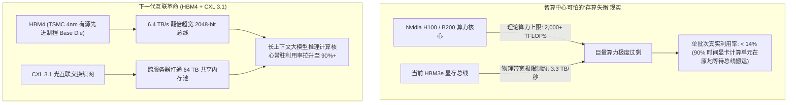

当科技媒体与公众讨论人工智能的算力竞争时，所有人的目光都紧紧盯着英伟达的芯片迭代：*从 Blackwell 到 Rubin，从 10 万卡集群到单机几十 PFLOPS 的浮点算力狂欢！*

然而在超大规模智算中心的硬件架构作战室里，资深系统工程师们面对的是一个残酷而冰冷的物理铁律：

**在当下的 AI 推理系统中，算力根本不是瓶颈，显存墙（The Memory Wall）才是掐死一切的死穴。**

现代 GPU 的张量计算核心（Tensor Cores）每秒能执行数千万亿次矩阵运算。但在大模型单用户生成的每一步中，这些昂贵的计算核心绝大多数时间都在原地“干等”——等待庞大的权重参数从高带宽显存（HBM）慢吞吞地通过铜线中介层搬运进芯片。

到了 2026 年，硅基中介层的寄生电容与散热功耗已经逼近半导体物理极限。AI 基础设施的决胜战场，不再是盲目堆砌计算核心，而是由 **HBM4 的 3D 有源逻辑底座** 与 **CXL 3.1 跨节点一致性内存池化（Memory Pooling）** 共同掀起的内存革命。

本文将拆解智算中心内存架构的底层微观物理机制，并介绍**「存算解耦拓扑模型」（The Memory-Compute Decoupling Topology）**。

---

## 一、显存墙的物理本质：为什么千亿显卡在原地“发呆”？

在大模型逐字生成的自回归推理阶段，系统的运行状态处于极端严苛的**显存带宽受限（Memory-Bandwidth Bound）**：

$$\text{算术强度 (Arithmetic Intensity)} = \frac{\text{实际执行的浮点运算次数 (FLOPs)}}{\text{从显存中搬运的字节总量 (Bytes)}}$$



以一个标准的 70B 模型为例，每生成一个单一的 Token，GPU 就必须把整整约 70 GB 的参数权重从显存搬运到计算核心一次。即便使用当下顶尖的 HBM3e 显存（3.3 TB/s 带宽），光搬运这组数据就硬生生需要 **21 毫秒**。

这意味着，无论你的显卡算力多么逆天，只要显存带宽跟不上，GPU 计算核心在绝大多数时间里都在空转。

---

## 二、HBM4 的技术突变：从无源中介层到 3D 有源先进制程底座

从 HBM3e 到 **HBM4** 的跨越，是近十年来半导体存储领域最具颠覆性的一次架构重构：

```
┌─────────────────────────────────────────────────────────────┐
│ 1. 16 层超薄 DRAM 芯片垂直堆叠 (16-High DRAM Die Stack)    │
│    通过数百万个微观垂直硅通孔 (TSV) 贯穿互联                │
├─────────────────────────────────────────────────────────────┤
│ 2. 有源 4nm 先进制程逻辑底座 (Active Base Logic Die)        │
│    - 彻底放弃传统无源硅基衬底，转向台积电/三星 4nm/3nm 制程  │
│    - 内嵌内存近场计算 (PIM)、动态 ECC 纠错与智能路由核心   │
├─────────────────────────────────────────────────────────────┤
│ 3. 2048-bit 超宽总线位宽 (相比 HBM3e 直接翻倍！)            │
│    - 单堆栈带宽冲上 6.4 TB/s (单机整卡显存带宽突破 25 TB/s) │
└─────────────────────────────────────────────────────────────┘
```

### HBM4 带来的三大质变：
1. **接口位宽翻倍（2048-bit）**：历史上所有 HBM 均被卡死在 1024-bit 接口上。HBM4 直接突破极限跃升至 2048-bit，引脚密度呈几何级数暴增。
2. **底座从“被动衬底”进化为“超级计算芯片”**：过去底部的 Base Die 只是单纯的电路走线中介层。HBM4 破天荒地采用台积电 4nm/3nm 的先进制程制造底座，使得**内存计算一体化（Processing-In-Memory）**成为现实，大量简单的解包与向量检索直接在显存堆栈内部完成。
3. **铜对铜无凸块直接键合（Direct Cu-Cu Hybrid Bonding）**：彻底剔除传统微凸块焊料，大幅降低了 16 层超高堆叠下的寄生电容与热阻，将工作温度死死压制在 105°C 降频红线之下。

---

## 三、搁浅内存的悲剧 vs. CXL 3.1 跨节点内存池化

HBM4 解决了极致的“吞吐速度”，但解决不了“容量与成本”：HBM 的堆叠工艺极其昂贵，在整台 AI 服务器的硬件物料清单（BOM）中，显存成本往往占到了 **60% 以上**！

为了避免巨额资本浪费，**CXL 3.1（Compute Express Link）** 应运而生：

```mermaid
graph LR
    subgraph TraditionalCluster ["传统孤立显存架构 (40% 显存被活活'搁浅'浪费)"]
        GPU1["服务器 A 的 GPU (跑超长上下文，显存 100% 撑爆)"]
        GPU2["服务器 B 的 GPU (跑短文本任务，显存只用 20%)"]
        GPU1 -.->|"跨节点无法共享借用！"| Fail["服务器 A 直接 OOM 崩溃退出"]
    end

    subgraph CXLFabric ["CXL 3.1 硬件缓存一致性分布式内存池"]
        GPUA["计算节点 A"] <===="PCIe Gen 6 / CXL 3.1 光纤交换机"====> Pool["独立的 32 TB 共享内存机柜"]
        GPUB["计算节点 B"] <===="PCIe Gen 6 / CXL 3.1 光纤交换机"====> Pool
        Pool --> Allocation["毫秒级动态内存吞吐借调 (全机房零搁浅内存浪费)"]
    end
```

### CXL 3.1 带来的革命性红利：
* **彻底根绝“搁浅内存”（Stranded Memory）**：传统 AI 机房中，多达 **40% 的显存容量被白白闲置**——节点 A 因为上下文过长显存不足而报错，旁边的节点 B 显存大量空闲却无法共享借调。
* **解耦超大长文本的 KV 缓存**：借助 CXL 3.1 协议的硬件缓存一致性保证，千万级 Token 的历史 KV Cache 可以从高昂的 HBM 中平滑卸载到共享的 CXL DDR5 内存池中，**直接将集群内存采购开销打掉 70%**。

---

## 四、下一代智算中心主流存储分层全景对比

| 存储介质层级 | 峰值读写带宽 | 单机/单池典型容量 | 核心硬件互联机制 | 在现代 AI 架构中的核心定位 |
| :--- | :--- | :--- | :--- | :--- |
| **服务器宿主内存 (DDR5)** | 300 GB/s – 600 GB/s | 1 TB – 4 TB | 主板标准 DIMM 插槽 | 操作系统常驻、原始海量数据分片预处理 |
| **HBM3e (Blackwell / MI300)**| 3.3 TB/s – 5.3 TB/s | 144 GB – 288 GB | 2.5D 硅基中介层 (CoWoS) | 模型主权重常驻、高频前向推理计算 |
| **HBM4 (2026 新一代标配)** | **6.4 TB/s – 10.0 TB/s**| **192 GB – 384 GB** | **3D 垂直混合键合 (Cu-Cu)** | **超前沿大模型权重、实时深度思考推理** |
| **CXL 3.1 弹性内存资源池** | 1.0 TB/s – 2.0 TB/s | **16 TB – 128 TB 共享大池**| **PCIe Gen 6 交换机 / 统一光网络**| **数千万超长上下文 KV Cache 的极致无感卸载**|

---

## 结语

人工智能竞赛的下半场，早已不是几篇论文或几个算法参数的简单调整，而是一场**凝聚态物理学、先进微观封装与精密光通信工程的综合国力较量**。

随着大模型算力成本持续被工程优化摊薄，算力 FLOPS 终将沦为随处可得的水电通用基础设施；而真正决定下一代 AI 智算中心生死存亡与商业壁垒的，唯有那些征服了显存物理极限、将芯片级 HBM4 与集群级 CXL 完美咬合的底层系统架构大师。
