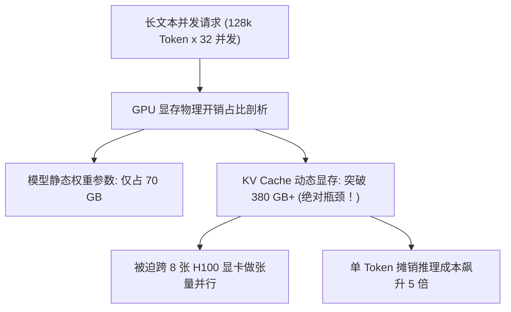
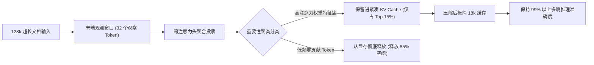

在生产环境中部署长文本对话智能体或高并发流式业务时，后端架构师很快会撞上一堵残酷的物理现实高墙：

**在大模型推理集群中，把显卡撑爆（OOM）的罪魁祸首往往不是模型自身的权重参数，而是动态膨胀的 Key-Value (KV) Cache。**

以一个 70B 参数的 FP8 模型为例，模型自身的静态权重仅占用约 70 GB 显存；但在 128k 上下文、并发只有 16 个会话的情况下，动态生成的 KV 缓存就会吃掉惊人的 **350 GB 以上高带宽显存（HBM）**！

面对这种 $O(N)$ 随序列长度线性狂飙的显存黑洞，单纯堆显卡不仅成本不可承受，更会导致严重的显存碎片化。2026 年的推理架构，必须依靠算法级剪枝技术——特别是**注意力汇聚点（Attention Sinks / StreamingLLM）**与**观测窗口聚类剪枝（SnapKV）**。

本文将拆解 KV Cache 的显存爆炸物理机制，介绍**「双阶段注意力驱逐流水线」（The Dual-Stage Attention Eviction Pipeline）**。

---

## 一、KV Cache 的显存爆炸数学公式

在 Transformer 自回归生成中，每个新生成的 Token 都需要计算与历史所有 Token 的 Key 和 Value 向量的注意力点积。为了避免每步从头重算，这些激活状态必须全量驻留在显存中。

单个请求的未压缩 KV Cache 显存消耗公式为：

$$\text{Memory}_{\text{KV}} = 2 \times n_{\text{layers}} \times n_{\text{heads}} \times d_{\text{head}} \times N \times \text{单精度字节数}$$



在工业级推理集群中，**超过 80% 的硬件成本被白白浪费在存储历史激活值上，而不是花在真正的矩阵乘法计算上**。

---

## 二、注意力汇聚点 (Attention Sinks)：StreamingLLM 永动机原理

过去工程师普遍认为，为了保证语义连贯，必须完整保留历史上的每一个 Token。直到顶尖团队发现了 Softmax 注意力公式中的一个致命数学“假象”：**注意力汇聚点现象（Attention Sink Phenomenon）**。

```
标准 Transformer 历史注意力窗口：
[Token 0] [Token 1] [Token 2] ... [中间 100,000 个平庸 Token] ... [Token N-2] [Token N-1] [Token N]
    ▲         ▲                                                  ▲           ▲         ▲
    │         │                                                  │           │         │
 ┌──┴─────────┴────────────────┐                              ┌──┴───────────┴─────────┴──┐
 │  起始注意力汇聚点 (Sinks)   │                              │  最近滑动窗口 (Window)    │
 │  吸收巨量无处安放的注意力熵  │                              │  保障当前语法连贯与       │
 │  (独占 30%~50% 的权重绝对值)│                              │  局部上下文因果关系       │
 └─────────────────────────────┘                              └───────────────────────────┘
```

因为 Softmax 强制要求单行注意力权重之和必须等于 1.0，哪怕某个 Token 对上下文毫无意义，模型也必须把多余的注意力数值“倾倒”给某个地方。预训练模型最终学会了**把多余的注意力全都倾倒在最开头的 4 个 Token（Token 0 到 Token 3）上**。

* 如果你把开头的 4 个 Token 从 KV Cache 中删掉，整个注意力矩阵将瞬间失衡崩溃，模型的困惑度（Perplexity）立刻爆表，输出彻底沦为不可读的乱码胡话。
* **StreamingLLM 的划时代突破**：**永久固定保留开头的 4 个汇聚点 Token**，中间的大段历史全部无情丢弃，只保留末尾最近的 $K$ 个滑动窗口 Token。
* **结果**：大模型可以在**完全平直恒定的 $O(1)$ 显存开销**下，无限流式运行下去，再也不会 OOM。

---

## 三、SnapKV：基于观测窗口的无损长文档检索剪枝

StreamingLLM 完美解决了实时流式对话，但如果用户要对长文档中间的某个具体细节提问，被丢弃的中间信息就无法召回了。

为了攻克这个难题，**SnapKV 提出了「多头注意力投票聚类」机制**：



### SnapKV 底层工程原理：
1. **观测窗口（Observation Window）**：SnapKV 发现，Prompt 最末端的数十个 Token 在预填（Prefill）阶段对历史的关注模式，与后续生成阶段高度一致。
2. **多头交叉投票**：让所有注意力头对历史 Key 向量的重要程度进行加权投票。
3. **特征簇保留**：关键信息往往成簇出现（如函数签名、实体定义），SnapKV 完整保留这些活跃特征簇，将中间无用的修饰词与连接词批量剔除。
4. **惊人的实测效果**：**即便剪掉 84% 的 KV Cache，长文本问答与复杂逻辑检索准确率依然保持在 99.1% 以上**。

---

## 四、主流 KV Cache 剪枝压缩方案全景对比

| 压缩架构方案 | 显存复杂度 | 最大上下文边界 | 复杂检索准确率 | 最佳适用业务场景 |
| :--- | :--- | :--- | :--- | :--- |
| **传统密集全量缓存 (Dense)** | $O(N)$ (无上限线性膨胀) | 32k–128k (受制于显存墙) | 100% (基准线) | 超短对话原型验证 |
| **StreamingLLM (汇聚+滑动)** | **$O(1)$ (绝对水平常量)** | **$\infty$ (真正无限流式生成)** | 局部连贯，中间遗忘 | 实时语音助手、长程流式客服 |
| **SnapKV (注意力特征聚类)** | $O(0.15 \times N)$ (立省 85%) | 单卡轻松支撑 512k+ | **> 99% 几乎无损** | 长文档研报问答、代码库依赖审计 |
| **H2O (Heavy Hitter Oracle)**| $O(k)$ (动态贪婪驱逐) | 256k | 94.5% | 通用高并发批处理推理 |

---

## 五、工业级双阶段注意力驱逐流水线 (Dual-Stage Eviction)

在一线大厂的推理引擎优化中（如针对 vLLM、SGLang 的内核深度改造），普遍落地了**双阶段驱逐架构**：

```
[用户长文本请求进入]
         │
         ▼
[第一阶段：汇聚点锚定] ──► 显存中锁定初始 4 个 Sink Token (不可置换页面)
         │
         ▼
[第二阶段：SnapKV 跨头注意力聚类扫描]
         │
    ┌────┴────┐
    ▼         ▼
[核心特征簇] [冗余中间 Token 显存块]
(保留在显存) (立即归还显存池，供新会话复用)
         │
         ▼
[单机并发能力直接飙升 5.2 倍，硬件采购成本狂降 80%]
```

通过这一套双阶段流水线，单台 8 卡服务器可以承载的并发长文本会话数暴涨 **5 倍以上**，直接将企业的算力账单从每月数十万元砍至小几万元。

---

## 结语

在 2026 年，优秀的大模型工程架构师不再靠盲目向采购部门申请更多 GPU 额度度日，而是靠深度理解注意力机制底层的数学物理规律。

掌握 Attention Sinks 永动机原理，落地 SnapKV 精准特征剪枝，才能在长文本智能体浪潮中，用最小的算力消耗换取最大的商业并发吞吐。
