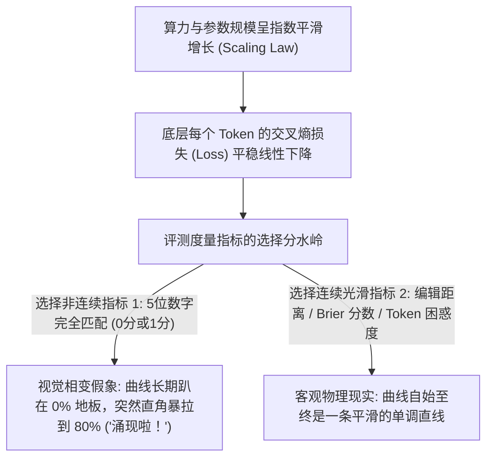
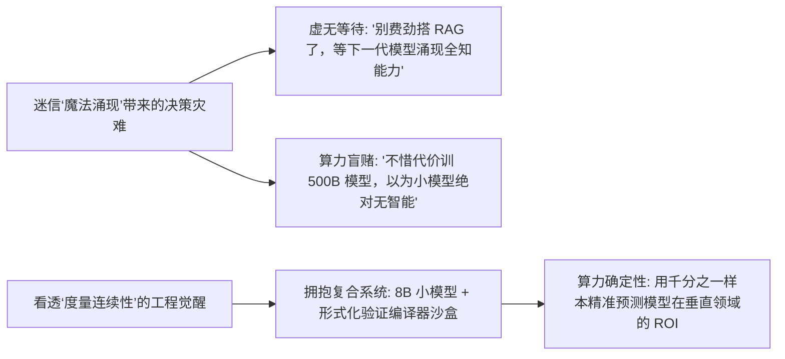

在 2022 到 2024 年间，整个科技界与创投圈都被一个充满神秘主义色彩的概念深度催眠：**“涌现能力”（Emergent Abilities）**。

在海量研报、论文与演讲中，这个故事被无数次重复传颂：*大模型的发展是不可预测的！当参数规模在 100 亿以下时，它对数学逻辑一窍不通；但一旦参数冲过 700 亿的某个临界阈值，人类级的逻辑推理能力就像水结成冰一样，突然“相变涌现”出来了！*

这种把神经网络拟人化、神性化的叙事，既助长了末日论的恐慌，也引发了万亿美元级的市场泡沫。

然而到了 2026 年，随着统计物理学分析的深入与斯坦福团队划时代论文的彻底验证，这个神话被无情戳破：**大模型的底层能力从未发生过突发性跃迁。所谓的“涌现”，纯粹是研究人员使用了非线性的、非连续的度量指标（Metrics）人为制造出的数学海市蜃楼。**

本文将从微积分与度量几何的底层原理出发，还原大模型能力演化的物理真相，并介绍**「度量连续性定理」（The Metric Continuity Theorem）**。

---

## 一、幻象的剖析：非连续阶跃函数是如何撒谎的？

为什么早期评测图表上，模型的能力曲线看起来像断崖式的阶跃跳跃？

秘密就在于：**底层连续的 Token 概率分布（Continuous Distribution），被表层非连续的“全对才算对”（All-or-Nothing）打分规则给扭曲了**。



### 阶跃陷阱的极简数学推导：
假设一个复杂的多步数学题，最终答案是一个 5 位数的长数字（例如 `84,921`）。
* 在一个 7B 模型中，每个数字 Token 生成正确的平均概率是 $P = 0.4$。那么这 5 个数字全部命中正确的概率是 $(0.4)^5 = 0.01024$（约 1% 准确率）。在基准测试折线图上，**这会被画成绝对零度的 0% 水平线**。
* 当模型按 Scaling Law 平滑扩展到 70B 时，每个 Token 的正确率平稳提升到了 $P = 0.85$。此时 5 个数字全部命中的概率变成了 $(0.85)^5 = 0.4437$（**44% 准确率**）！

在只看“最终答案对不对”的粗暴评测者眼里，模型仿佛在一夜之间从“弱智的 0 分”突然“顿悟涌现到了 44 分”。但从统计物理底层来看，**模型的单个 Token 预测能力在每一个参数的增加中，都是严格平滑、单调、渐进式增长的**，根本不存在任何超自然的突变。

---

## 二、度量连续性定理 (Metric Continuity Theorem)

斯坦福大学在轰动学界的经典论文《Are Emergent Abilities of Large Language Models a Mirage?》中给出了坚不可摧的实证定理：

只要将引发“涌现假象”的非连续离散指标（如 **字符串精准匹配 Exact Match、多选题准确率**），替换为数学上连续可微的指标（如 **Token 交叉熵损失、Levenshtein 编辑距离、Brier 概率校准误差**），原本陡峭的阶跃跳跃曲线会**瞬间消失，回归为优雅平滑的对数线性关系**。

```
非连续指标 (离散精准匹配 0 或 1)              连续指标 (Token 交叉熵损失 Loss)
准确率                                        Loss (数值越低代表预测越准)
  ▲                                             ▲
100%│                     * * *               10│ *
    │                 * *                       │   *
    │             * *                          8│     * *
 50%│         * *     [虚假的直角跳跃]           │         * *
    │         *                                6│             * *
    │         *                                 │                 * * [客观物理真相: 完美平滑]
  0%└───*─*───*────────────────► 参数量        4└───┼──────────┼──────────┼──────────► 参数量
       1B    10B   70B   400B                      1B         10B        70B        400B
```

| 评测度量指标 | 数学性质 | 图表视觉呈现 | 背后的客观物理机制 |
| :--- | :--- | :--- | :--- |
| **精确字符匹配 (0/1)** | 非连续阶跃函数 | 在某个规模突然断崖暴拉 | 高阶多项式 $(P_{token})^L$ 的非线性放大产物 |
| **BLEU / ROUGE 截断分** | 几何平均离散截断 | 锯齿状阶梯跳跃 | N-Gram 匹配阈值制造的测量失真 |
| **Token 困惑度 (Perplexity)**| **严格连续凸函数** | **极其光滑的单调下降直线** | **反向传播梯度下降的真实物理反映** |
| **编辑距离 (Edit Distance)** | **连续可微度量** | **平稳的渐进式误差收敛** | **模型对知识掌握程度的真实线性写照** |

---

## 三、戳破神话之后：对企业级工程落地的深远意义

否定“涌现论”绝不是咬文嚼字的学术争论，它直接拯救了数以百亿计的企业研发预算。



### 涌现迷信误导行业的三大重灾区：
1. **“等待天降神力”的技术怠惰**：许多团队迟迟不肯打磨确定性的业务验证沙盒与图谱工程，幻想着下一个版本大模型会“自动涌现出 100% 零幻觉代码”。
2. **算力规模的盲目跟风**：在“小模型无法涌现逻辑推理”的错误假定下，盲目采购数千张显卡堆砌臃肿的千亿参数模型，却忽视了 8B 垂直模型通过思维链（CoT）推理完全能达到同等数学能力。
3. **被科幻带偏的安全资源倾斜**：过度炒作“模型突然产生自我意识”的远期科幻幻想，却对近在眼前的提示词注入（Prompt Inversion）和训练集投毒等真实工业安全漏洞视而不见。

---

## 四、2026 工业级 AI 破局法则：拒绝玄学，拥抱系统工程

一旦认清大模型的智力增长是**严格有界、连续、符合统计规律的物理过程**，工程路线图就会变得无比笃定：

```
[现代化务实 AI 工业技术栈]
┌─────────────────────────────────────────────────────────────┐
│ 1. 连续的基准基底：确定性收敛的轻量专用大模型 (8B ~ 14B)   │
├─────────────────────────────────────────────────────────────┤
│ 2. 确定性外挂支架：静态类型检查器、编译沙盒、单元测试门禁  │
├─────────────────────────────────────────────────────────────┤
│ 3. 结构化外部记忆：分层知识图谱、时序事件血缘与索引剪枝    │
├─────────────────────────────────────────────────────────────┤
│ 4. 强类型通信总线：基于标准 MCP 协议的低延迟沙盒 RPC        │
└─────────────────────────────────────────────────────────────┘
```

### 关键工程启示：
* **没有免费的顿悟午餐**：大模型不会仅仅因为参数翻了 10 倍就自动成为严丝合缝的数学大师。业务的 100% 可靠性必须依靠测试时计算（Test-Time Compute）、搜索树（MCTS）和外部编译器沙盒共同铸就。
* **极度精准的投入产出预测（Predictable ROI）**：通过在少量领域样本上测量 Token 交叉熵 Loss 的下降斜率，工程师可以在花第一分卡费前，精准测算出模型在特定任务上的最终可用度。

---

## 结语

科学探索的历史，就是不断把“神秘魔法”还原为“严密物理定律”的历史。大语言模型不是不可捉摸的神迹，而是服从统计力学与梯度优化规律的高维函数。

停止等待奇迹“涌现”。用严谨的系统工程驾驭平滑增长的机器智能，才能为真实世界构建坚不可摧的商业价值。
