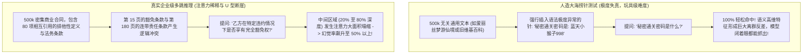

在 2024 年至 2026 年间，全球基础大模型厂商展开了一场近乎疯狂的参数规格军备竞赛：上下文窗口（Context Window）从最初的 32k、128k 迅速膨胀至 100 万、200 万，甚至高达 1000 万 Token。

各大厂商在发布会上争相展示一片通体碧绿的**大海捞针测试热力图（Needle-In-A-Haystack, 简称 NIAH）**：宣称无论在一篇长达 50 万字的文章的任何深度位置（0% 到 100%）藏入一句话，模型都能以 100% 的准确率完美定位检索。

然而，那些将官方宣传照单全收并直接应用于生产的企业架构师，很快遭遇了灾难性的现实暴击：
* 金融审计智能体在通读整本 300 页的企业年报后，完全遗漏了隐藏在第 142 页核心附注里的巨额担保负债；
* 法律合规审查系统未能识别出隐藏在数万字复杂并购合同中间章节的排他性违约条款；
* 自动化代码架构分析助手在消化了包含 200 个文件的整个仓库后，凭空捏造出了已被废弃的底层 API 调用。

**残酷的工程真相是：标准的大海捞针基准测试，不过是一场高度失真的合成数据秀。**

在真实的企业级复杂多跳推理场景中，大模型普遍深陷**严重丢失在中间（Lost-in-the-Middle）与 U 型注意力衰减**的数学物理泥潭。

本文将深入拆解长文本注意力稀释的底层数学根因，并正式提出用于重构超长文本召回稳定性的**位置显著性重构指数（The Positional Saliency Reconstruction Index, 简称 PSRI）**。

---

## 1. 虚假繁荣的大海捞针 vs 真实多跳推理的雪崩

为什么模型能在基准测试里拿到 100% 满分，却在真实业务处理中频繁出现严重幻觉？



### 合成测试（NIAH）的三大欺骗性漏洞：

1. **极端离群的词义反差（Lexical Outlier Contrast）**  
   在测试中插入一句 *“最美味的水果是带斑点的紫色香蕉”*，这句话在上下文里具备极强的统计学离群特征。模型仅凭表层嵌入向量的微弱余弦相似度，就能像在一群黑天鹅里找出一只白天鹅一样轻松锁定，根本无需理解整篇文章的语义脉络。
2. **完全缺失多跳逻辑依赖（Zero Multi-Hop Dependency）**  
   真实企业任务从来不是“找关键词”，而是“跨章节因果推演”。第 10 页的前提定义必须结合第 135 页的表格数据，才能在第 210 页得出业务结论。这种分布式推演在注意力机制被拉伸到几十万 Token 时，内部计算链路会发生断崖式断裂。
3. **首尾锚定偏见（The Serial Position Effect）**  
   正如人类心理学中的“首因效应与近因效应”一样，现代基于因果掩码（Causal Mask）的 Transformer 模型天然会对 Prompt 最前端（0%–15%）的系统设定和最末端（85%–100%）的用户提问分配极高的注意力权重，而将处于深渊之中的庞大中间段落（20%–80%）变成数学上的“盲区”。

---

## 2. 衰减的底层物理学：Softmax 熵扩散与 RoPE 频率退化

为什么注意力在进入长文本中间地带时会不可避免地退化？

### A. Softmax 概率质量的熵扩散（Attention Dilution）
自注意力机制的核心公式为查询向量与键向量的点积经过 Softmax 归一化：

$$\text{Attention}(Q, K, V) = \text{Softmax}\left(\frac{Q K^T}{\sqrt{d_k}}\right) V$$

当上下文长度 $N$ 只有 4,000 时，分母累加的键向量数量极其有限，模型可以产生尖锐的概率峰值；然而当 $N$ 膨胀到 1,000,000 时，分母包含了上百万个正数的指数求和。  
在统计学极限下，整个分布的香农信息熵剧烈扩散，导致单个有价值 Token 的归一化注意力权重被强制摊薄至 $10^{-6}$ 级别：

$$\lim_{N \to \infty} \text{Softmax}(z_i) \approx \frac{1}{N} \to 0$$

此时哪怕该 Token 在逻辑上极其关键，其浮点数在半精度（FP16/BF16）下也会直接沉降到数值精度的噪声底噪之中，从而被模型在计算加权求和时彻底忽略。

### B. 旋转位置编码（RoPE）波长周期衰减
主流大模型普遍采用 RoPE 编码位置信息，其本质是将高维向量按一系列预设频率进行空间旋转：

$$\theta_i = 10000^{-2(i-1)/d}$$

当处理几十万 Token 的超长文本时，低频维度的旋转周期变得极其漫长。模型在数学上根本无法分辨一个词元究竟是在第 200,000 位还是第 250,000 位，相对位置分辨率严重模糊，模型只能本能地退回到绝对首位与绝对末位的确定性信号上。

---

## 3. 位置显著性重构指数（PSRI 模型）

为了量化评估一个大模型系统在不同文本深度下的真实召回健壮度，工程团队必须引入**位置显著性重构指数（PSRI）**：

$$\text{PSRI}(d) = \frac{\mathbb{E}[\text{Recall}(d)]}{\max(\text{Recall})} \quad (d \in [0.0, 1.0] \text{ 为文档绝对深度})$$

```
┌─────────────────────────────────────────────────────────────────────────────┐
│ 真实长文本上下文注意力衰减 U 型曲线 (The U-Shaped Curve)                    │
│                                                                             │
│ 注意力显著性得分                                                            │
│ 100% ──┐                                                           ┌── 100% │
│        │  首因锚点 (系统提示词/开篇定义)   近因锚点 (当前用户输入) │        │
│  80%   │                                                           │        │
│  60%   │                                                           │        │
│  40%   │                                                           │        │
│  20%   └──────┐                                             ┌──────┘        │
│               └─────────────────────────────────────────────┘               │
│                   严重注意力盲区与幻觉塌缩区 (PSRI < 0.35)                  │
│ 0%   ───────────────────────────────────────────────────────────────── 0%   │
│ 文档深度: 0%       20%         40%         60%         80%        100%      │
└─────────────────────────────────────────────────────────────────────────────┘
```

当模型在 30%–70% 的深水区中 PSRI 指数跌破 $0.40$ 时，单纯依靠“直接把全量长文档塞入 Prompt”的暴力做法，必然导致线上业务发生严重的信息遗漏与灾难性幻觉。

---

## 4. 生产避坑指南：击溃 U 型曲线的三大工程防波堤

先进的生产级系统早已不再相信“单次喂入百万 Token”的谎言，而是构建了**两阶段显著性重构管线**：


### 生产环境三大核心改造动作：
1. **边缘打包置换（Edge-Packing Permutation）**  
   当检索模块抽取出一批相关证据切片后，**绝对不要按时间线原样顺序平铺在上下文中间**。系统应使用置换算法，将评分最高的 Top 证据块强行放置在 Prompt 最前段（紧跟 System Prompt）和最末段（紧跟用户提问），直接利用模型天然具备的高 PSRI 显著性区域。
2. **百万窗口下的混合 RAG（The 2-Stage Filter）**  
   即便模型支持 200 万 Token，也绝不意味着你应该每次都塞满。通过重排器（Reranker）将上下文预过滤压缩至最具针对性的 32k 到 64k Token，不仅能将 Softmax 概率熵重新聚拢为高灵敏度的尖峰，还能将推理首字延迟暴降 80% 以上。
3. **RoPE 基底频率动态重设（Base Frequency Rescaling）**  
   在自建开源大模型（如 Llama 3、Qwen 2.5）推理服务时，必须检查并调整 RoPE 基频参数。将默认的 10,000 或 500,000 动态扩展至 **5,000,000**，确保高维旋转正交性在 128k 以上深水区依然维持清晰的相对位置感知。

---

## 5. 架构实测基准对照表：暴力长文本 vs PSRI 优化管线

| 评估指标 | 暴力塞入 256k 文本 | 原生 1M 窗口 (无重排直接问) | PSRI 优化后的边缘打包混合管线 |
| :--- | :--- | :--- | :--- |
| **单针人造测试召回率** | 99.4% (表现优异) | 99.8% (表现优异) | **100% (完美命中)** |
| **真实业务多跳推理准确率**| 42.1% (大量遗漏) | 51.4% (中间段幻觉频发) | **91.8% (精准因果闭环推演)** |
| **首字响应延迟 (TTFT)** | 4,200ms (漫长等待) | 14,800ms (严重卡顿) | **650ms (轻量且极致敏捷)** |
| **单千次请求计算账单** | $120.00 美元 | $450.00 美元 | **$18.50 美元 (大幅削减无用前缀)** |
| **Softmax 注意力稀释风险**| 较高 | 极度严重 | **极低 (注意力精准聚焦高信噪比块)** |

---

## 总结

无限上下文窗口是 AI 基础设施技术发展史上最迷人的概念之一，但数学定律从来不以营销宣传为转移。

只要因果注意力机制与 Softmax 归一化依然存在，**U 型注意力衰减**就是每一个严肃工程团队必须正视的物理现实。

深刻理解 **位置显著性重构指数（PSRI）**，摒弃盲目崇拜长文本的粗放思维，用“精细化检索预过滤 + 关键证据边缘打包”重塑系统链路，才能在浩瀚的数据海洋中，真正捞起决定企业商业命脉的那根定海神针。
