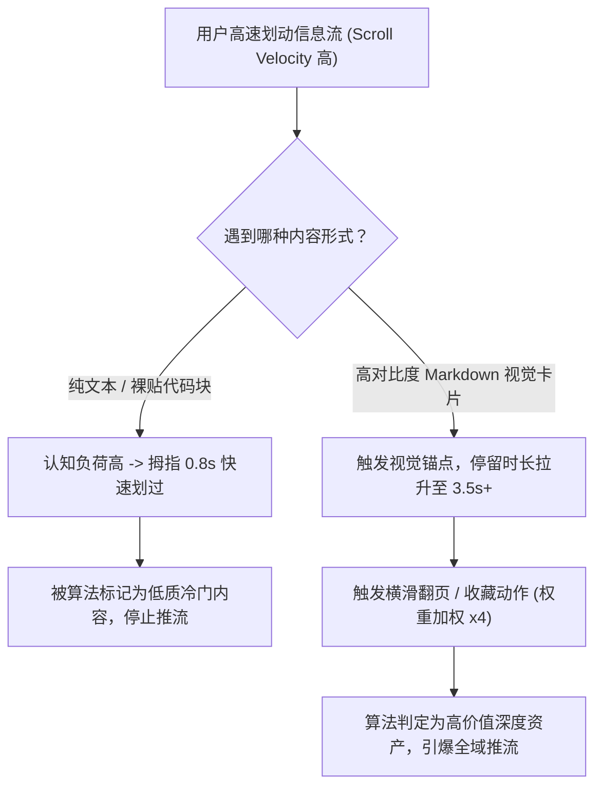

如果你是一位开发者、技术博主或独立开发者（Indie Hacker），在 X（Twitter）或 LinkedIn 上分享技术干货时，大概率遇到过这种尴尬：

**精心打磨的 30 行核心架构代码，发出去只有寥寥几个赞，曝光量少得可怜。**

在当下的社媒推荐算法中，平台最核心的考量指标只有两个：**停留时长（Dwell Time）** 与 **微交互率（Micro-Engagements，如滑动轮播图、放大图片、点击收藏）**。

当用户在信息流里刷到一大坨密密麻麻的单色纯文本时，大拇指划过的时间通常不会超过 0.8 秒；而当他们看到一张高对比度、带优雅代码高亮与设计感的视觉卡片时，视觉停留系统会被瞬间激活。

本文将拆解开发者信息流背后的注意力认知机制，并提供一套**「4 页微叙事闭环模型」（The 4-Slide Micro-Narrative Loop）**，教你把干瘪的 Markdown 文档一键转化为高转化的视觉资产。

---

## 一、2026 年社媒信息流的算法注意力底层逻辑

现代推荐算法不再只看表面的点赞量，而是精准计算**信息密度与滑动速度的对抗比**。



### 抓住工程师眼球的 3 大视觉触发器：
1. **代码语法高亮条件反射**：工程师的大脑经过长期训练，对带有语法着色（关键字紫色、字符串绿色、类型蓝色）的卡片识别速度比单色纯文本快 5 倍以上。
2. **横滑翻页加权**：在 LinkedIn 和小红书/Instagram 等平台，用户从第 1 页滑到第 2 页的动作会被算法识别为极高权重的深度交互。
3. **收藏（Bookmark）溢价**：排版精致的知识卡片天然具备“参考手册（Cheat-Sheet）”的属性，能带来高达 8 倍以上的收藏保存率。

---

## 二、4 页微叙事闭环模型 (The 4-Slide Micro-Narrative Loop)

为了在极短的幻灯片轮播中实现最高的信息传达效率，技术卡片应严格遵循**「4 页微叙事闭环」**结构：

```
┌─────────────────┐   ┌─────────────────┐   ┌─────────────────┐   ┌─────────────────┐
│ 第 1 页：视觉钩子 │   │ 第 2 页：反模式陷阱│   │ 第 3 页：优雅解法 │   │ 第 4 页：思维清单 │
│                 │   │                 │   │                 │   │                 │
│ 巨大悬念大标题   ├──►│ 常见的错误/糟糕代码├──►│ 优雅重构与Diff高亮├──►│ 核心原则总结+CTA │
│ + 场景痛点标识   │   │ + 红色标注气泡   │   │ + 绿色优化标注   │   │ + 引导关注/收藏 │
└─────────────────┘   └─────────────────┘   └─────────────────┘   └─────────────────┘
```

| 幻灯片序号 | 认知职责 | 排版设计规则 | 典型呈现内容 |
| :--- | :--- | :--- | :--- |
| **第 1 页** | **锚点钩子 (Hook)** | 醒目大标题，高反差背景，无杂乱信息 | 抛出痛点（如：*“90% 开发者都在滥用的 React 性能死锁”*） |
| **第 2 页** | **反模式呈现 (The Bug)** | 红色警告边框，展示反面典型 | 6～8 行有代表性的糟糕代码片段 |
| **第 3 页** | **优雅解法 (The Fix)** | 绿色高亮边框，代码 Diff 对比 | 优雅精简的重构代码与底层运行逻辑 |
| **第 4 页** | **思维清单 (Takeaway)** | 结构化表格或 3 条黄金法则 | 记忆清单 + 引导用户点击收藏和工具试用 |

---

## 用 NavoKit 整理一张 Markdown 卡片

在 [NavoKit Markdown 转图片](/zh/tools/markdown-to-image) 中粘贴较长提纲中的一页卡片内容。用标题、列表、表格或代码块组织内容，检查实时预览，再导出 PNG。转换在浏览器中完成，图片包含 NavoKit 标识。

当前界面采用固定的白色卡片样式，没有主题、语法高亮、窗口边框、透明背景或画幅比例选择器；也不提供 PDF、矢量或批量导出。图片高度随内容变化，长内容需要先拆分。

制作轮播或演示文稿时，请逐张整理和导出，再在发布平台或演示工具中组合。 保留可复制的原始文本与代码链接，让图片起到辅助说明的作用。

## 结语

在 2026 年的注意力经济时代，内容的呈现品质决定了你思想的传播上限。

告别干瘪的纯文本输出，把你的技术洞察、代码重构和核心逻辑变成人人争相收藏的精美视觉卡片，轻松击穿各大社媒算法的流量池。
