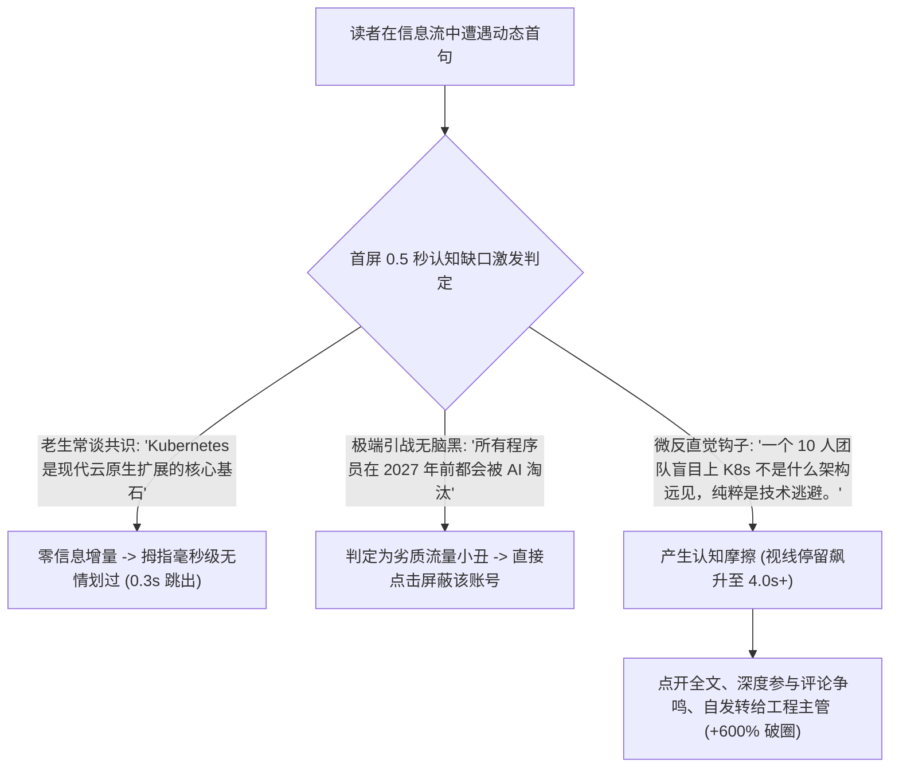

如果你是一位创始人、资深架构师或技术布道师，想在 X（Twitter）或即刻/LinkedIn 上建立自己的专业影响力，你大概率在两条极端弯路之间痛苦摇摆：

左边是**“死气沉沉的企业官号机器人”**风格：机械地转发官网博客链接，配上一句礼貌客套的导读，发出去只有 2 个点赞，没有任何有效互动。

右边是**“硅谷式油腻网红（Cringe Influencer）”**风格：满屏大惊小怪的鸡汤体，开头动辄 *“我通宵研究了乔布斯的 100 场演讲，总结了这 7 条能让你人生翻倍的底层思维（建议收藏）🧵👇”*。

到了 2026 年，这两种风格在专业技术圈都已经彻底宣告破产。

真正的资深架构师、工程 VP 与企业决策者，对无脑的鸡汤清单已经产生了生理层面的厌恶与拉黑冲动。真正能穿透信息流、引发高质量转发与技术争鸣的，是**「微反直觉钩子」（The Micro-Contrarian Hook）：一种基于严密工业实证、以极其克制的口吻戳破行业皇帝新衣的认知表达**。

本文将拆解技术信息流的认知神经心理学，并介绍**「反共识张力框架」（The Counter-Consensus Tension Framework, CCT）**。

---

## 一、信息流疲劳 vs. 反共识认知缺口

为什么平铺直叙的共识没人看，而微反直觉的洞察能让技术决策者瞬间停下滚轮？



### 优秀微反直觉钩子的三大原则：
1. **坚决不做无脑引战（No Rage-Bait）**：用反智言论博眼球只能换来评论区的冷嘲热讽，彻底摧毁你的专业声誉。
2. **捍卫房间里的大象（Empirical Ground Truth）**：挑破那些业内一线资深工程师私下心知肚明、但被营销厂商和自媒体刻意粉饰的技术真相。
3. **制造极度诱人的信息差（Information Gap）**：第一句话打破传统常理，第二句话直接砸出不可辩驳的冷酷生产数据。

---

## 二、反共识张力框架 (CCT Framework)

想要写出既锋利扎心、又显得沉稳厚重的技术文案，请严格遵循**「反共识张力框架（CCT）」**的四步演化：

```
┌─────────────────────────────────────────────────────────────┐
│ 1. 砸碎被奉为圭臬的图腾 (Challenge an Industry Sacred Cow) │
│    - “90% 的所谓微服务重构，本质上只是烂代码的包装转移。”  │
├─────────────────────────────────────────────────────────────┤
│ 2. 砸出不加滤镜的冷酷指标 (The Hard Unvarnished Metric)     │
│    - “我们上周把 18 个分布式微服务合并成一个单体二进制，    │
│       P99 延迟直接暴降 80%，AWS 账单直接腰斩。”             │
├─────────────────────────────────────────────────────────────┤
│ 3. 揭露皇帝新衣的人性根因 (The Sociological Insight)        │
│    - “简历驱动开发（RDD）让技术团队宁可解决分布式竞态死锁， │
│       也不愿意坐下来重构最基础的数据表。”                   │
├─────────────────────────────────────────────────────────────┤
│ 4. 交付克制实用的黄金法则 (The Pragmatic Heuristic)         │
│    - “在你的工程师团队突破 100 人之前，老老实实用单体架构。” │
└─────────────────────────────────────────────────────────────┘
```

| 行业领域痛点 | 令人作呕的油腻网红写法 | CCT 工业级微反直觉实战范式 |
| :--- | :--- | :--- |
| **关于 AI 辅助编程** | *“AI 正在让所有程序员效率暴涨 100 倍！这 10 个神级插件你必须知道 🚀”* | *“AI 编程工具从来不会让平庸的代码变好，它只会以前所未有的速度暴露出到底哪些所谓的资深架构师根本不懂底层系统设计。”* |
| **关于早期融资** | *“拿到数千万融资后，我关于创业韧性与格局的 5 点深刻复盘……”* | *“被 40 家 VC 拒绝是我们 SaaS 公司经历过的最幸运的事。它逼得我们在第 1 天就必须直接找真实客户收钱。”* |
| **关于数据库架构性能** | *“收藏这篇干货！手把手教你如何设计支撑 10 亿用户的超大规模分布式数据库架构！”* | *“如果你的核心业务数据用一张 64GB 内存条就能装得下，你遇到的从来不是海量大数据问题，纯粹是索引没建好。”* |
| **关于技术人员成长** | *“想要在科技大厂年薪百万，这 3 个不可替代的高效工作习惯一定要养成！”* | *“工程师最稀缺的高杠杆能力，从来不是快速手写复杂算法，而是能用严密的成本账本说服产品经理直接把那些没用的功能砍掉。”* |

---

## 用 NavoKit 起草，再人工核对

把一个具体技术观点及其依据写进 [NavoKit AI 社媒文案](/zh/tools/ai-social-booster) 的输入框，也可以用文字补充受众和语气要求。工具会请求生成 X、LinkedIn、Instagram 文案及开场句，供你选择、编辑和复制。

界面没有语气预设选择器或可读性评分循环，也不承诺提高流量。生成草稿不能证明本文其他部分讨论的框架或效果数据。

保留能核实的事实，删除未经证实的数字、个人经历和效果承诺；最后由你检查平台长度、语气与内容，再自行发布。

## 结语

在社交网络上，最打动技术决策者的文字，绝不是那些人云亦云的“正确废话”。

而是你替所有人说出了他们今天早晨盯着臃肿系统架构时，心里最想拍案而起的那句清醒真话。

善用反共识张力框架，做技术浪潮中保持清醒的少数派，让真正高净值的同行与企业客户主动向你聚拢。
