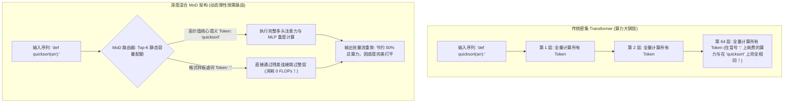

在传统的 Transformer 大模型架构中，所有的 Token 都在享受极其僵化且荒谬的“算力均贫富待遇”：

不论大模型当前正在处理的是一个毫无语义信息的逗号 `,`、一个闭着眼睛都能猜到的语法虚词（如英文中的 `"the"`），还是一个关乎复杂数学逻辑推导的关键算子，**每一个 Token 都被迫完整穿过整个模型全部 64 层（甚至 128 层）庞大的自注意力机制与前馈全连接网络**。

这在计算资源上是一种极其挥霍的低效浪费。

在人类真实的阅读中，我们扫过虚词只需毫秒级的眼球跳跃，遇到核心论点才会停驻大脑深度思考。

在 2026 年，由 Google DeepMind 提出并快速在各大开源大模型架构中落地的 **深度混合机制（Mixture-of-Depths, MoD）**，彻底打破了这种静态均质的算力分配。通过在网络层前置超轻量的动态路由器，**让模型自主决定哪些高价值 Token 值得进入深度计算，哪些低信息熵 Token 直接通过残差连接跳过整层运算**，在**下游基准测试完全无损**的前提下，将整体推理算力（FLOPs）暴砍 **50%**！

本文将拆解 MoD 动态路由的底层数学机制，并介绍**「Token 计算弹性模型」（The Token Computational Elasticity Model）**。

---

## 一、传统均匀算力假象 vs. 深度动态跳层

为什么传统大模型的算力分配存在巨大的结构性浪费？



### 传统层层硬推的低效死穴：
* 在绝大多数代码与日常文本中，**超过 65% 的 Token 属于语法填空性质的低熵填充物**。强行让它们一遍又一遍通过数十亿参数的矩阵乘法，除了白白加热机房芯片、霸占显存带宽外，没有任何实质信息增量。
* 与大家熟知的“专家混合架构（Mixture-of-Experts, MoE）”不同：MoE 是在**横向空间**把 Token 分发给不同的前馈网络专家；而 MoD 是在**纵向时间/深度维度**让 Token 自主选择“是否跳过计算”，实现了真正的结构瘦身。

---

## 二、MoD 的核心数学原理：静态容量限制与 Top-$K$ 门控

很多尝试跳层机制的算法之所以失败，是因为动态生成的张量形状会导致 GPU 并行计算碎裂。

MoD 之所以能在工程上完美落地，关键在于引入了**「静态容量因子」（Static Capacity Factor, $C$）**：

```
[输入 Token 隐层表征: X ∈ R^{B × S × D}]
                     │
                     ▼
       [路由器轻量线性投影向量: w_r ∈ R^D]
                     │
                     ▼
          [计算每个 Token 的标量权重得分: R(X) = X · w_r]
                     │
                     ▼
             [Top-K 门控截断层]
      (在整条序列中，仅严格保留前 K = C × S 个得分最高的 Token)
                     │
      ┌──────────────┴──────────────┐
      ▼                             ▼
[中选的 Top-K 核心 Token]    [未中选的普通 Token]
      │                             │
      ▼                             ▼
[进入 Attention 与 MLP 密集计算]   [直接绕过本层，通过残差通道恒等传递]
      │                             │
      └──────────────┬──────────────┘
                     ▼
          [无缝重组后的下层输入序列]
```

### 固定容量公式与张量对齐：
在处理长度为 $S$ 的序列时，MoD 强制规定本层允许进入深度计算的最大 Token 上限为固定的 $K$：

$$K = \lfloor C \times S \rfloor$$

工业界通常将容量因子设置为 $C = 0.50$。路由器计算出所有 Token 的重要性打分后，**只有排名前 50% 的精英 Token 会真正进入昂贵的自注意力与 FFN 计算；剩下 50% 的普通 Token 直接原封不动走残差跳过，消耗的计算量严格为 0 FLOPs**！

因为 $K$ 的大小在推理和训练前就已经由序列长度静态锁死，**所有张量在显存中的物理尺寸始终整齐划一**，消除了动态批处理的碎片化问题，将英伟达 Tensor Core 的算力利用率拉满。

---

## 三、MoD（深度混合）vs. MoE（专家混合）架构深度对比

| 架构设计维度 | 传统专家混合 (MoE) | 深度混合跳层 (MoD) | MoD + MoE 混合体 (MoDE) |
| :--- | :--- | :--- | :--- |
| **路由分配轴向** | 横向维度（在不同的稀疏 MLP 专家间横跳）| **纵向深度维度（直接选择跳过整层计算）** | 二维立体矩阵（纵向跳层 + 横向分流） |
| **显存占用开销 (VRAM)**| 巨大（必须常驻 8~16 个专家的海量权重）| **极低（完全维持标准单体模型的精简显存）**| 中等偏高 |
| **单步真实 FLOP 节约** | 依赖激活专家比例，不跳层 | **直接硬生生砍掉 50% 的单步矩阵计算量** | **最高可狂砍 75% 的整体算力** |
| **跨 GPU 通信惩罚** | 存在高昂的 All-to-All 跨卡跨机通信延迟 | **零跨卡跨进程网络通信开销** | 极低 |
| **KV Cache 显存瘦身** | 必须全量缓存所有 Token 的 Key/Value | **可选择性只为中选 Token 存 KV 缓存** | 显著缩小 KV 缓存体积 |

---

## 四、Token 计算弹性模型：哪些词在偷懒？哪些词在拼命？

大模型的路由器在实际训练中，究竟学会了把算力倾斜给谁？

通过对数亿条代码与复杂推理语料的激活权重进行逆向分析，我们提炼出了**「Token 计算弹性模型」**：

```
路由器算力分配优先级别打分
  ▲
1.0│ * * * [逻辑分叉与状态转移 Token: 'if', 'return', 'class', 'SELECT']
   │
0.7│         * * * [专有命名实体与架构关键字: 'quicksort', 'Postgres']
   │
0.4│                 * * * [普通动词与核心修饰词: 'calculates', 'connects']
   │
0.1│                         * * * * * * [格式样板垫话: '{', '}', ',', 'the', 'is']
  0└───┼──────────┼──────────┼──────────┼──────────┼──────────► Token 语义信息密度
```

* **100% 全程参与所有层的核心词**：逻辑分支判断符、函数声明、算术运算符号以及关键的领域专用实体名。
* **常年跳过 70% 计算层的偷懒词**：括号、冒号、换行空格、日常系动词与从属连词。它们只需通过底层的浅层嵌入和残差连接，就足以维持全局语法的连贯性。

---

## 五、生产环境落地收益：线上推理并发直接翻倍

在生产级推理引擎（如针对 vLLM / TensorRT-LLM 的定制魔改分支）中：

1. **吞吐量翻倍（2x Concurrency）**：因为单次生成过程中跳过了整整一半的浮点矩阵乘法运算，同一套 GPU 集群可以在**不增加一张显卡的前提下，承载原本 2 倍以上的真实高并发请求**。
2. **动态显存优化（Selective KV Cache）**：未被选中参与特定层计算的 Token，可以完全不写入该层的 KV Cache，直接帮显存再次减负 30% 以上。
3. **权威评测全量无损**：在主流的 MMLU、GSM8K 与 HumanEval 代码榜单中，经过 MoD 架构训练的模型，其综合表现与同等计算量下训练的传统密集大模型毫无劣势，甚至在部分长程推导中泛化性更强。

---

## 结语

在底层算力日益昂贵的时代，盲目强迫每一个无意义的字符在百层神经网络里“陪跑”，是早期架构幼稚性的历史遗留。

深度混合（MoD）证明了智能的真谛在于**把有限的算力用在最刀刃的复杂逻辑上**。拥抱纵向动态路由，砍掉一半的冗余算力，是用系统工程在激烈的 AI 成本内卷战中杀出重围的终极法宝。
