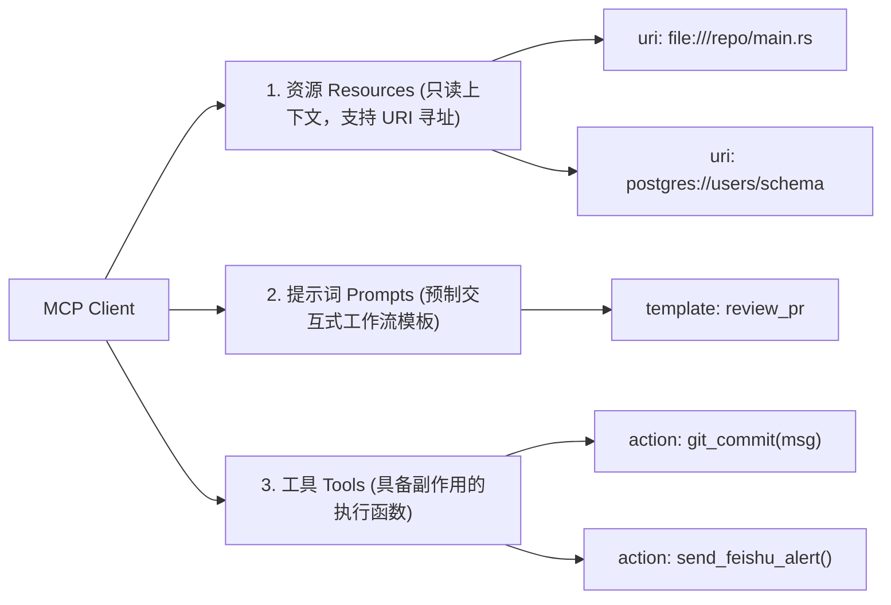

在 2023 到 2025 年初，几乎所有开发 LLM 智能体（Agent）的团队都在重复同一个痛苦的架构错误：为每一个外部工具、API 接口与数据库编写定制化的 JSON 胶水代码。

如果你内部有 5 个微服务，并希望接入 3 个不同厂商的模型（Anthropic、OpenAI、本地开源小模型），你就必须开发并维护 $5 \times 3 = 15$ 套定制适配器。每一套适配器都要单独处理入参解析、报错格式、速率限制与鉴权生命周期。

这种 **$M \times N$ 的网状集成泥潭**，是企业级智能体研发效率的隐形杀手。

而 Anthropic 推出并迅速成为开源事实标准的 **Model Context Protocol（MCP，模型上下文协议）**，从根本上终结了这一碎片化局面。正如当年微软提出的 LSP（Language Server Protocol）统一了 IDE 与各编程语言的交互一样，MCP 将大模型应用（Host）与底层的数据和工具提供者进行了彻底解耦。

本文将从传输层、能力协商机制到安全沙盒，深入拆解 MCP 的底层架构，并介绍**「三层 MCP 解耦拓扑模型」（The 3-Tier MCP Decoupled Topology）**。

---

## 一、$M \times N$ 难题与 MCP 通用协议的诞生

在 MCP 诞生前，工具完全与特定模型的 Function Calling Schema 强绑定。一套为 OpenAI `tools` 参数编写的定义，换到 Anthropic 的 `tool_choice` 或开源框架中，经常因为空值处理或类型推断差异而静默崩溃。

```mermaid
graph TD
    subgraph Legacy ["传统混乱网状架构 (M x N 胶水代码)"]
        A1[智能体 A] --> T1[Postgres 数据库]
        A1 --> T2[GitHub API]
        A2[智能体 B] --> T1
        A2 --> T3[Slack 机器人]
        A3[智能体 C] --> T2
        A3 --> T3
    end

    subgraph MCPTopology ["MCP 通用解耦拓扑 (M + N 线性标准)"]
        Host1[Claude 客户端 / 专属宿主] --> Client[MCP Client 客户端]
        Host2[Cursor / IDE 编程智能体] --> Client
        Client <===="JSON-RPC 2.0 (stdio / SSE)"====> S1[MCP Server: Postgres]
        Client <===="JSON-RPC 2.0 (stdio / SSE)"====> S2[MCP Server: GitHub]
        Client <===="JSON-RPC 2.0 (stdio / SSE)"====> S3[MCP Server: Slack]
    end
```

### 为什么 MCP 能彻底解开架构死结：
1. **标准化通信协议**：废弃了各家随意的 REST 接口拼凑，底层统一采用成熟轻量的 **JSON-RPC 2.0**，支持本地进程间标准输入输出（`stdio`）以及跨网络的服务端推送事件（`SSE`）。
2. **动态能力协商握手**：客户端与服务端建联时，双方会握手协商支持的三大核心原语：**资源（Resources）**、**提示词（Prompts）** 与 **工具（Tools）**。
3. **一次编写，全网通用**：数据库团队只需编写一个符合 MCP 标准的 Server，这个 Server 就可以直接插进 Claude Desktop、Cursor、企业内部的 LangGraph 集群以及终端 CLI Agent 中，零修改开箱即用。

---

## 二、三层 MCP 解耦拓扑架构 (The 3-Tier Topology)

MCP 规范将智能体系统清晰地划分为三个职责严格隔离的层级：

```
┌─────────────────────────────────────────────────────────────────┐
│ 1. MCP Host (AI 宿主应用层)                                     │
│    - 驱动大模型推理循环、用户界面交互、安全授权确认框           │
│    - 调度管理全局上下文预算 (Token Budget)                      │
└───────────────────────────────┬─────────────────────────────────┘
                                │ 内部 API 调用
┌───────────────────────────────▼─────────────────────────────────┐
│ 2. MCP Client (协议客户端代理)                                  │
│    - 负责维持与多个 MCP Server 的 1:1 有状态长连接             │
│    - 分发 JSON-RPC 消息、心跳探测与响应反序列化                 │
└───────────────────────────────┬─────────────────────────────────┘
                                │ stdio / SSE 传输通道
         ┌──────────────────────┼──────────────────────┐
         ▼                      ▼                      ▼
┌──────────────────┐   ┌──────────────────┐   ┌──────────────────┐
│ 3a. 本地 Server  │   │ 3b. 内部远端服务 │   │ 3c. 第三方 SaaS  │
│ (本地文件系统/Git)│   │ (内网数据库/ES)  │   │ (Jira/GitHub/云) │
└──────────────────┘   └──────────────────┘   └──────────────────┘
```

| 架构分层 | 核心职责 | 故障隔离范围 |
| :--- | :--- | :--- |
| **MCP Host** | 运行大模型主交互循环、提供 UI 渲染、负责弹窗向用户索取工具执行权限。 | UI 进程崩溃或单次推理 Token 耗尽。 |
| **MCP Client** | 负责维护连接池、协议版本自适应、生命周期心跳与参数预检校验。 | 某个 Server 离线不影响其他连接的继续运行。 |
| **MCP Server** | 纯粹的领域工具执行体（如查询 SQLite、触发 Webhook、拉取 PR 变更）。 | 上游 API 500 报错或数据库死锁，通过 RPC 错误码回传。 |

---

## 三、三大核心抽象原语：资源、提示词与工具

与传统 Function Calling 把所有东西都混作一个随意命名的函数不同，MCP 在语义层面做了严格的三元划分：



### 1. 资源 (Resources)：确定性被动只读注入
* 通过标准 URI 寻址：如 `file:///workspace/src/lib.rs` 或 `postgres://cluster/metrics`。
* 完全只读、无副作用。智能体可以“订阅（Subscribe）”资源更新，当服务端文件变动时，实时自动将 Diff 推送进智能体上下文。

### 2. 提示词 (Prompts)：领域专家打包的业务流
* 由服务端直接暴露的高级工作流模板（如 `/auto-debug`、`/sql-audit`）。
* 领域后端工程师可以在编写数据库工具的同时，将最佳调用姿势和边界提示词封装在一起，调用方无需自己瞎猜 Prompt。

### 3. 工具 (Tools)：具备状态变更的执行函数
* 涉及写操作或网络请求的确定性 RPC 动作。
* MCP 原生强制支持 **人工介入确认（Human-in-the-Loop）**：当模型决定调用高危工具时，Host 可以自动拦截并弹出确认界面，用户点击同意后才真正执行。

---

## 四、传统 Function Calling 与 MCP 架构深度对比

| 架构维度 | 传统私有 Function Calling | Model Context Protocol (MCP) |
| :--- | :--- | :--- |
| **耦合度** | 与具体大模型供应商 SDK 深度死锁 | 完全模型无关；统一通过 JSON-RPC 2.0 解耦 |
| **传输通道** | 粗暴硬塞在单次 HTTP 推理请求的 Body 中 | 专有独立通道（`stdio` 进程管道、HTTP/SSE、WebSockets） |
| **有状态性** | 纯无状态；每轮对话都需要全量重发庞大的工具描述 | 支持有状态握手、本地能力缓存与事件驱动式订阅 |
| **安全边界** | 仅靠前端应用逻辑隐式拦截 | 协议层原生支持能力分级与单动作权限授权 |
| **维护成本** | 引入新 Agent 框架就要把所有工具全重写一遍 | 统一工业标准；任何新智能体秒级即插即用 |

---

## 五、生产环境 MCP 安全落地准则

将拥有系统调用权限的 MCP Server 暴露给自主智能体，如果缺乏安全防护，极易引发**远程代码执行（RCE）与权限越权提权**。

```
[MCP Client] ───(JSON-RPC: tools/call)───► [内核安全网关 / 沙盒]
                                                    │
                   ┌────────────────────────────────┴────────────────────────────────┐
                   ▼                                                                 ▼
      [针对标准输入输出 Stdio 管道]                                    [针对网络 SSE 远程服务端]
      - 隔离运行在专属低权限 UID/GID                                   - 强制 Mutual TLS (mTLS) 双向证书认证
      - 挂载 Read-Only 只读文件系统                                    - 严格限定内网 IP 访问白名单
      - 限制可派生的子进程最大数量                                     - 零信任 Bearer Token 鉴权
```

### 生产级防御三大铁律：
1. **本地进程命名空间隔离**：本地 `stdio` 类型的 Server 严禁直接以宿主机器当前管理员身份拉起，必须包裹在轻量 Docker 容器或 macOS 沙盒规则中。
2. **高危动作强制双重确认**：对包含 `rm -rf`、`git push --force`、`DROP TABLE` 等破坏性动作的工具，利用 MCP 的授权握手，强制阻断自动执行。
3. **入参全量强类型防御（Zod / Pydantic）**：所有来自 LLM 的参数必须在 Server 端进行白名单正则与类型校验，严防通过字符串拼接进行 Shell 命令注入。

---

## 结语

智能体技术的上半场解决了“怎么让大模型使用工具”，而下半场的焦点在于“如何建立工业级的互操作标准”。

就像当年 REST 统一了 Web API、LSP 统一了代码编辑器，**MCP 正在迅速成为自主智能体时代的通用总线**。在 2026 年，继续编写碎片化的定制函数胶水代码已是不可承受的技术债务；全面接入 MCP，是构建高弹性企业级 Agent 架构的必然选择。
