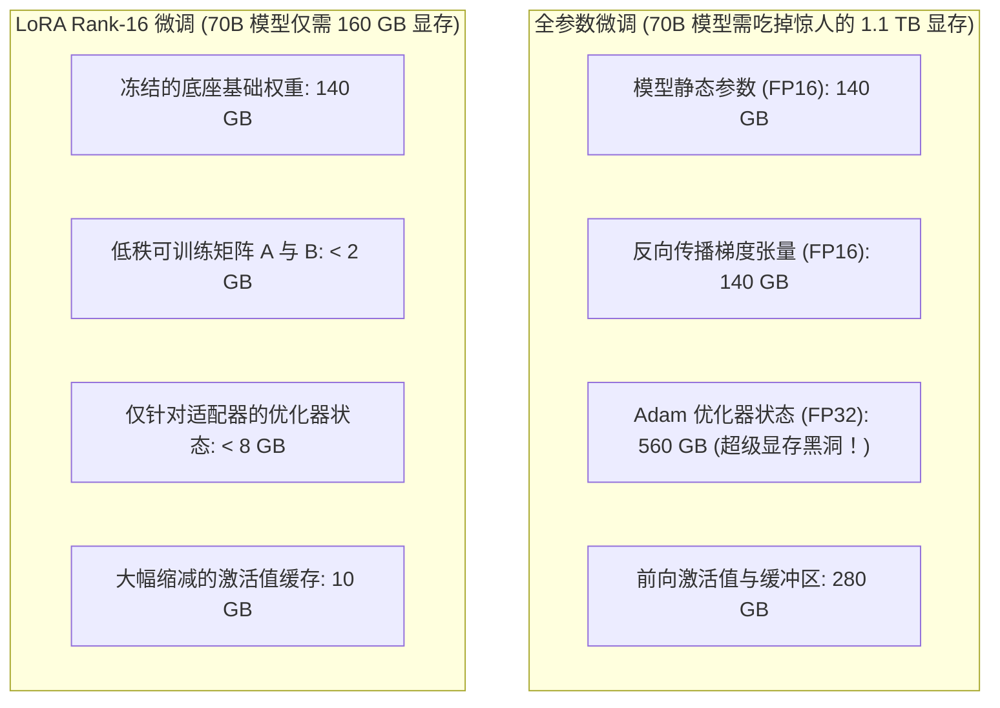
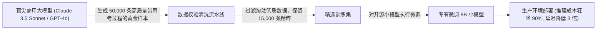

在生成式 AI 的早期狂热期，几乎每个技术团队都喊着“我们要训练自己的垂直行业基座大模型”。

但到了 2026 年，无论是企业 CFO 还是工程副总裁，都已经被冰冷的财务报表教育得极其清醒：**从头预训练大模型是少数万亿巨头的资本碎纸机，而毫无节制的全参数微调（Full Fine-Tuning）绝大多数时候也是灾难性的资金浪费。**

将当下的开源顶流权重（如 Llama-3.3、Mistral、Qwen）适配到企业的专有数据时，工程师必须在**显存占用、适配器切换延迟、灾难性遗忘与长期线上推理单位成本（Unit Economics）**之间做出严密的数学权衡。

究竟该使用低秩微调（LoRA）？量化微调（QLoRA）？全参数梯度更新？还是通过顶尖商业模型对小参数模型进行知识蒸馏（Distillation）？

本文将为你算清大模型后训练（Post-Training）的真实财务与技术账本，并介绍**「模型自适应效率前沿曲线」（Adaptation Efficiency Frontier, AEF）**。

---

## 一、显存物理学：算力预算究竟被谁吃掉了？

要理解为什么全参数微调的硬件成本往往是 LoRA 的 15 倍以上，必须看清反向传播过程中 GPU 显存真实的开销构成。



### 昂贵的“Adam 优化器税”：
* 在标准 AdamW 优化器中，为了更新每一个模型参数 $\theta$，系统都必须额外存储两个 32 位浮点数状态：一阶动量（Momentum）和二阶方差（Variance）。
* 这意味着，对于一个 70B 模型，仅仅是存储优化器状态，就硬性需要 **$70 \times 10^9 \times 8 \text{ 字节} = 560\text{ GB}$ 的纯物理显存开销**！这甚至完全还没算 Batch Size 和上下文长度占用的显存！
* **LoRA 的降维打击**：LoRA 直接冻结庞大的原始权重矩阵 $W_0 \in \mathbb{R}^{d \times k}$，仅仅训练两个低秩小矩阵 $A \in \mathbb{R}^{r \times k}$ 和 $B \in \mathbb{R}^{d \times r}$（$r$ 通常只有 16 或 32）。优化器状态瞬间从 560 GB 暴跌至不足 8 GB。

---

## 二、模型自适应效率前沿曲线 (AEF)

企业在决定技术路线时，必须根据自身的“专有知识注入深度”与“预算约束”准确定位在效率前沿上：

```
垂直领域专有知识注入深度
  ▲
极深│                                           [全参数微调 Full Fine-Tuning]
    │                                     * * * *
    │                              * * *
中等│                       * * * [LoRA / DoRA Rank-64]
    │                * * *
浅层│         * * * [QLoRA 4-bit 量化微调]
    │  * * * [纯 Prompt 工程 / RAG 知识库]
  0%└───┼──────────┼──────────┼──────────┼──────────┼──────────►
       $100      $1,000     $10,000    $50,000   $250,000+   综合训练总体拥有成本 (TCO)
```

| 微调策略 | 70B 模型所需最低硬件 | 典型训练单次耗费成本 | 多租户线上部署开销 | 新领域知识内化深度 |
| :--- | :--- | :--- | :--- | :--- |
| **纯 Prompt RAG** | 无需训练卡（调用 API） | \$0 前期成本 | 长期 Token 消耗极高 | 零（不改变内部参数） |
| **QLoRA (4-bit)** | 2张 A100 (80GB) | \$80 – \$300 | 极佳（毫秒级热插拔 LoRA 权重） | 格式指令极高，硬核知识中等 |
| **LoRA (BF16)** | 4张 A100 (80GB) | \$400 – \$1,500 | 极佳（单底座支持数百个客户专属 LoRA）| 强任务对齐，几乎无灾难性遗忘 |
| **全参数微调** | 16张 H100 (80GB) | \$12,000 – \$45,000 | 极其高昂（每个模型需独立占用 8 卡）| **极深（能重构深层因果理解）** |
| **教师蒸馏小模型** | 商业 API + 4张 A100 | \$2,500 – \$8,000 | **极其廉价（线上只跑 8B 端侧小模型）**| 目标任务极强，通用闲聊能力退化 |

---

## 三、什么时候必须全参数微调？什么时候千万别用？

### 必须动用全参数微调的极少数场景：
1. **注入全新的自然语言或底层编译语法**：如果你的任务是让模型精通冷门的 COBOL、Erlang 语言，或者处理纯古拉丁语、特殊医学代码。因为底层词表与嵌入层（Embedding）需要大规模变异，LoRA 的低秩子空间无法容纳如此巨大的分布位移。
2. **彻底颠覆模型的原生推理范式**：例如强制改变模型的思维链（Chain of Thought）自纠错策略。

### 其余 95% 的场景，请坚决锁死在 LoRA / QLoRA：
* **多租户 SaaS 架构**：你可以只在显存里常驻一个共享的 70B 底座模型，为 500 家企业客户分别维护一个几十兆大小的 LoRA 权重文件，利用 vLLM 的 Multi-LoRA 特性按请求动态挂载，**服务器开销直接锐减 90%**。
* **特定排版与业务格式对齐**：让输出严格遵循企业内部的 JSON Schema 或法律条款合规标准。

---

## 四、降本大招：教师-学生模型知识蒸馏 (Distillation)

在 2026 年，最具商业回报率的工程动作是**模型蒸馏**：



聪明的团队绝不会在生产环境中为每一次重复的数据提取调用 20 美元/百万 Token 的巨无霸模型。

相反，他们先花几百美元让顶尖模型作为“虚拟专家教师”生成 2 万条带推理步骤的黄金标注样本，然后将其蒸馏进一个轻量级的 8B 开源模型中。在专属业务场景下，**这个 8B 小学生的表现能达到教师模型 98% 的准确率，而线上推理成本直接砍掉 93%**！

---

## 结语

从头练模型是科技巨头争夺入场券的军备竞赛；而用最低的成本部署高确定性、低延迟的垂直智能，才是软件工程师的真本领。

停止在不必要的全参数微调中空耗资本。用好 LoRA 的多租户红利，打好小模型蒸馏的算盘，把每一分算力都转化为实实在在的商业利润。
