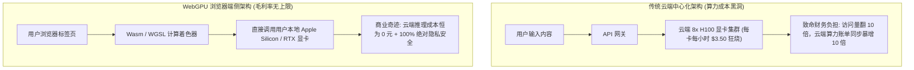
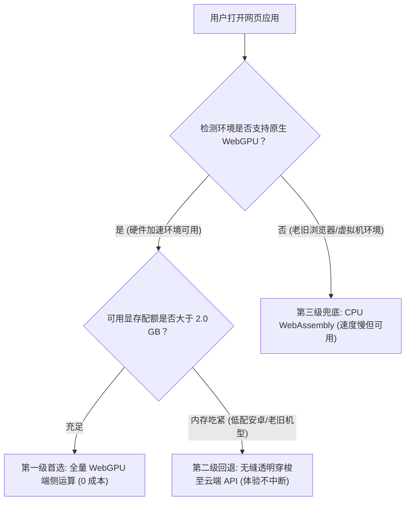

多年以来，所有 AI SaaS 产品负责人的终极商业梦想都是同一个：**让云端推理边际成本归零**。

如果能直接借助用户电脑或手机上的芯片硬件（Apple M 系列核显、N卡、甚至是轻薄本核显），通过浏览器原生的 **WebGPU** 技术，在客户端本地直接跑 1B~3B 的轻量大模型、Whisper 语音听写或图像抠图分割，那么企业每个月数万美金的云端 GPU 账单将会在一夜之间**断崖式清零**。

到了 2026 年，这项技术已经彻底跨过了早期的玩具 Demo 阶段，每天有数以百万计的真实用户在浏览器端本地执行神经网络前向计算。

然而，将推理任务从恒温机房的 H100 集群下放到千奇百怪的用户端设备时，工程师必须直面一系列冷酷的工业级现实：**WGSL 着色器编译卡顿、浏览器标签页强制内存截杀、轻薄本过热降频与离线缓存失效黑洞**。

本文将剥开技术营销的泡沫，深度拆解生产环境中落地 WebGPU 端侧推理的硬核技术细节，并介绍**「端侧推理可行性矩阵」（The Client-Side Inference Viability Matrix）**。

---

## 一、架构大迁徙：云端集中算力 vs. 浏览器 WebGPU 边缘计算

为什么越来越多的企业顶着兼容性风险，也要死磕端侧推理？



### 驱动端侧计算的三大商业铁律：
1. **毛利率无限膨胀**：无论是 100 个用户还是 1,000 万个用户，平台为单次推理支付的云端算力费用**严格为 0.00 美元**。
2. **绝对隐私免疫合规审查**：敏感的企业财务数据、用户录音或医疗病历从来不需要离开本地电脑，天然规避 GDPR、HIPAA 等严苛的数据出境审查。
3. **离线高响应能力**：即使在高铁上或断网环境中，本地小模型依然能以极低延迟完成文本结构化处理。

---

## 二、真实生产环境中 WebGPU 的四大暗礁

在本地测试很顺畅的 WebGPU，一推向真实海量用户，就会暴露四大典型物理瓶颈：

```
┌─────────────────────────────────────────────────────────────────┐
│ 暗礁 1：首次冷启动下载悬崖 (Cold-Start Churn)                   │
│   - 一个 3B 量化模型体积约 1.8GB，在移动端 4G 下导致 40% 用户流失│
├─────────────────────────────────────────────────────────────────┤
│ 暗礁 2：WGSL 着色器动态编译卡死 (First-Token Jitter)            │
│   - 浏览器首次运行需将着色器源码动态编译为底层驱动字节码，卡顿 5 秒│
├─────────────────────────────────────────────────────────────────┤
│ 暗礁 3：操作系统内存配额熔断 (Tab Eviction)                     │
│   - iOS Safari 与 Android Chrome 会无情强杀内存超 1.5GB 的标签页 │
├─────────────────────────────────────────────────────────────────┤
│ 暗礁 4：轻薄本发热降频 (Thermal Throttling)                     │
│   - 连续推理 8 分钟后，轻薄本风扇狂转，主频直接骤降 60%        │
└─────────────────────────────────────────────────────────────────┘
```

| 核心评估维度 | 云端标准集中式推理 (H100) | 浏览器 WebGPU 本地端侧推理 |
| :--- | :--- | :--- |
| **单次推理成本 (COGS)** | \$0.02 – \$0.15 / 千 Token | **\$0.000 (完全免费，由用户买单)** |
| **首次使用冷启动耗时** | 200ms（热容器秒级响应） | **12 秒 – 40 秒（依赖模型下载与编译）** |
| **延迟稳定性** | 极高（机房恒温稳定供给） | 极不稳定（取决于用户电池电量与后台负载） |
| **支持模型上限** | 70B – 405B 超强大脑 | **1B – 3.8B 垂直小参数模型 (SLM)** |
| **数据合规风险** | 需签署严苛的第三方数据处理协议 | **绝对零泄露风险（数据物理层面不离网）** |

---

## 三、端侧推理可行性矩阵 (Viability Matrix)

绝不是所有的 AI 功能都适合强行塞进浏览器。在架构立项前，必须对照**「端侧推理可行性矩阵」**评估：

```
模型参数规模与网络下载体积
  ▲
14B│                                           [严禁端侧：必须保留在云端]
   │                                           (70B 深度推理模型, 文生视频扩散模型)
 7B│
   │                              [临界带：必须配合分片预加载]
 3B│                       * * *  (需要强依赖本地 IndexedDB 持久化)
   │                * * *
 1B│         * * * [端侧黄金落地甜蜜区 (WebGPU 稳定生产级)]
   │  * * *        (Whisper 语音听写, 文本向量嵌入, 1.5B 语法格式化)
 0 └───┼──────────┼──────────┼──────────┼──────────┼──────────►
      1s         5s         15s        30s        60s+       用户可容忍的首次初始化窗口
```

### 适合 100% 运行在 WebGPU 的明星场景：
* **本地向量嵌入生成（Embedding）**：模型体积仅 30MB~80MB，下载后秒级常驻，实现数千条本地文档的毫秒级语义搜索。
* **本地离线语音听写（Whisper-Base）**：120MB 模型文件，直接吃麦克风实时音频流，转写速度达真实时间的 8 倍以上。
* **结构化 JSON 校验与清洗器（1B SLM）**：在前端直接阻断非法输入，保护后端安全。

---

## 四、工业级 WebGPU 生产韧性架构设计

要保证 WebGPU 应用在各种奇葩设备上不翻车，必须搭建**「三级渐进降级兜底架构」**：



### 生产级落地三大军规：
1. **显存分片持久化（IndexedDB + ETag 缓存）**：绝不能每次刷新页面都让用户重新下载 1GB 模型。必须把权重切分为 50MB 的小 Blob 切片写入 IndexedDB，并用 Service Worker 做离线管理。
2. **坚决隔离至 WebWorker 线程**：禁止在 UI 主线程执行任何 WebGPU 调度。繁重的张量计算会导致页面滚动卡死、鼠标点击无响应，直接触发浏览器的“页面无响应崩溃弹窗”。
3. **静默无感云端兜底（Cloud Teleportation）**：如果检测到用户当前电量不足 10% 或触发了系统的降频保护，静默将推理任务抛回云端服务器，保障用户体验零感知断崖。

---

## 结语

WebGPU 绝不是科技公司的纯宣传噱头，而是一柄能彻底重写 AI 产品利润表与商业护城河的核武器。

认清端侧硬件的物理局限，做好优雅降级，把最耗费算力的边缘小任务还给用户的设备，才是 2026 年最具商业智慧的架构决策。
