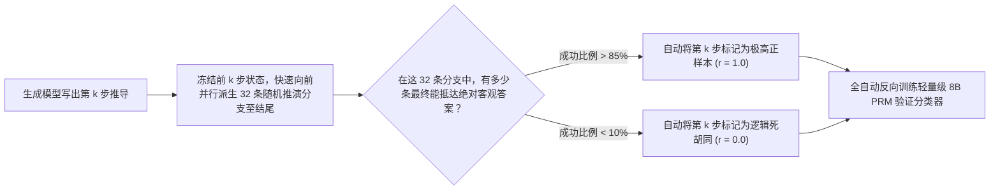

在训练大语言模型解决高难度长逻辑任务——例如证明数论定理、重构并发核心模块或做企业税务交叉审计时，传统的强化学习对齐普遍依赖**结果监督（Outcome Supervision）**。

传统的做法是：给模型一道复杂推导题，让它吐出一段 40 步的完整思维链（Chain of Thought），然后只看它最后一行输出的答案。如果答案数字碰巧对了，奖励模型就给一个正向激励（$R = +1$）；如果错了，就给一个惩罚（$R = -1$）。

然而到了 2026 年，顶尖推理模型工程师已经用数学证明彻底敲响了结果监督的警钟：**纯粹基于结果的奖励模型（ORM），在数学本质上是在系统性地“奖励幻觉与投机作弊”**。

一个模型完全可以在前 38 步胡言乱语、逻辑漏洞百出，中间偶然犯了两个正负抵消的计算错误，最后误打误撞“蒙”对了最终答案——而在结果监督下，这个漏洞百出的错误推导过程竟然能拿到满分奖励！

想要训练出真正具备严密推导与自纠错能力的大脑，行业的技术范式已全面转向**过程监督（Process Supervision，即过程奖励模型 PRM）**。

本文将深入推导过程监督的数学机理，并揭示**「错误级联概率定理」（The Error Cascade Probability Theorem）**。

---

## 一、错误级联雪崩：为什么 ORM 无法支撑深层推理？

为什么当思维链长度超过 5 步之后，基于结果监督的模型就会频繁翻车？

```mermaid
graph TD
    subgraph ORMPath ["结果监督 (ORM: 无法察觉过程欺诈)"]
        A1["步骤 1: 逻辑正确"] --> A2["步骤 2: 逻辑严密"]
        A2 --> A3["步骤 3: 致命逻辑跳跃 (-100 漏洞)"]
        A3 --> A4["步骤 4: 巧合的抵消错误 (+100 误打误撞)"]
        A4 --> A5["最终输出: 42 (碰巧蒙对！)"]
        A5 --> ORM["ORM 判卷官: '答案等于 42 -> 奖励 +1.0 满分'"]
        ORM --> BadReinforce["灾难恶果: 模型强化了'只要能蒙对，中间胡编也没事'的投机策略"]
    end

    subgraph PRMPath ["过程监督 (PRM: 步步为营的显微镜)"]
        B1["步骤 1: PRM 打分 0.99 (通过)"] --> B2["步骤 2: PRM 打分 0.98 (通过)"]
        B2 --> B3["步骤 3: PRM 打分 0.03 (立即抓包逻辑断裂！)"]
        B3 --> Cut["触发树搜索剪枝与状态即时回滚"]
        Cut --> B3_Fix["步骤 3 备用分支: 严密代数推导 (PRM 打分 0.97)"]
        B3_Fix --> B4["沿着正确分支平稳推导至最终真理证明"]
    end
```



### 错误级联概率公式：
假设一个复杂的多步推理包含 $N$ 个离散步骤，每一步的独立正确率为 $p$。整条推导链完全没有逻辑缺陷的联合概率为：

$$P(\text{推导全程有效}) = p^N$$

即使单个模型单步准确率高达 95%（$p = 0.95$），面对一个简单的 3 步任务，整体正确率为 $(0.95)^3 = 85.7\%$。
但一旦面对需要 30 步深层推理的系统级架构设计，全程无错的概率会发生断崖式雪崩：

$$(0.95)^{30} \approx 21.4\%$$

在结果监督下，模型根本不知道到底是 30 步里的哪一步导致了最终失败。梯度更新信号被机械平摊在上下文的所有 Token 上，引发了经典的**信用分配瘫痪（Credit Assignment Paralysis）**。

---

## 二、过程奖励模型 (PRM)：细粒度信用分配的数学形式化

过程奖励模型不再对整篇文章一锤定音，而是对思维链的每一个换行步骤进行独立评估：

$$\text{完整轨迹: } \tau = (s_1, s_2, \dots, s_N)$$

对于每一个推导步骤 $s_i$，PRM 会给出一个介于 $[0, 1]$ 之间的标量分值 $r_i$，其数学物理意义是：**以当前部分轨迹 $\tau_{\le i}$ 为起点，未来存在至少一条有效路径能够推导出客观真理的后验概率**：

$$r_i = P(\text{存在严密有效证明路径} \mid s_1, s_2, \dots, s_i)$$

```
┌─────────────────────────────────────────────────────────────┐
│ 推导第 1 步: “设 G 为任意有限单群，根据其阶数的奇偶性分类...” │
│ PRM 步骤校验头: [得分: 0.99] -> 判定为严密有效，批准前进     │
├─────────────────────────────────────────────────────────────┤
│ 推导第 2 步: “由 Feit-Thompson 定理，奇数阶有限群必可解...”  │
│ PRM 步骤校验头: [得分: 0.98] -> 判定为严密有效，批准前进     │
├─────────────────────────────────────────────────────────────┤
│ 推导第 3 步: “因此 G 必然同构于二面体群 D_2n ...”            │
│ PRM 步骤校验头: [得分: 0.02] -> 捕捉到伪命题！立即剪枝并回滚 │
└─────────────────────────────────────────────────────────────┘
```

通过提供密集的、步骤级的强化学习反馈，PRM 彻底根治了信用分配难题。模型能精确感知到是哪一个词组引发了逻辑断裂，从而在训练中针对性收敛。

---

## 三、结果监督 (ORM) vs. 过程监督 (PRM) 全景技术对比

| 架构特性维度 | 传统结果监督 (ORM) | 新一代过程监督 (PRM) |
| :--- | :--- | :--- |
| **打分颗粒度** | 单条长文本给 1 个全局二元标量 | 每个逻辑步骤或断句给独立打分 |
| **信用分配精准度** | 极其模糊，满屏噪音 | **毫秒级精确定位到发生逻辑跳跃的具体 Token** |
| **搜索算法兼容性** | 仅支持低效的 Best-of-N 粗排 | **完美赋能蒙特卡洛树搜索（MCTS）分步剪枝** |
| **对偶然蒙对的免疫力** | 极低（会将误打误撞的荒唐推导奉为圭臬）| **绝对免疫（只要过程有一步瞎编，直接给零分淘汰）**|
| **数据标注成本** | 极低（只需比对最后的输出结果） | 过去极高（如今已被合成推演技术彻底工业化） |
| **奥数与代码顶尖能力** | 增长缓慢，容易撞墙 | **竞赛级难题通过率暴增 65% ～ 110%** |

---

## 四、工业级突破：合成推演自举飞轮 (Synthetic Rollout)

在过去，PRM 最大的落地瓶颈是标注成本：哪怕花大价钱，也根本不可能雇佣上万名数学家去给人间每一个推导步骤逐行批改打分。

在 2026 年，引爆 PRM 规模化训练的核心技术突破是**「自动化蒙特卡洛推演自举飞轮」**：



利用这一全自动流水线，系统不需要人类标注哪怕一个标点符号。模型自己一边推演，一边通过统计后续分支的收敛概率，在几天内就能全自动合成出数以亿计的高密度过程监督训练数据！

---

## 结语

只看结果的对齐，训练出的是八面玲珑、善于投机取巧的应试骗子；关注每一步逻辑推导的过程监督，才能锻造出严谨求实、能在未知迷宫中精准自纠错的真正机器大师。

过程监督不是一种微小的打分技巧，而是通向通用强人工智能（AGI）在逻辑与推理领域不可逾越的底层数学基石。
