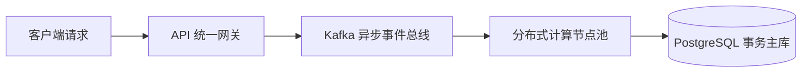

如果你经常编写技术文档、系统设计方案（RFC）或维护开源 GitHub 仓库，你一定对 **Mermaid.js** 的强大威力深有体会。仅仅需要寥寥数行简洁的声明式文本，你就能精确勾勒出一个高并发微服务集群、一条基于 Kafka 的流式处理管道，或者一段严密的分布式共识算法时序：



在 GitHub、Notion 或开发文档里，这段代码会被渲染成极其干净的交互式矢量拓扑图。

**但是，当你尝试将这套极其精妙的技术架构分享到 LinkedIn、X（原 Twitter）、即刻或微信技术社群时，灾难发生了：**

* 主流社交媒体的信息流根本无法解析原生 Mermaid 语法，你的心血在手机屏幕上沦为一堆毫无格式美感的原始 Markdown 代码块；
* 如果你顺手用系统自带的截图工具截一张图，生成的位图在 Retina 屏幕上字体发虚、抗锯齿模糊，横向过宽的比例在窄屏手机信息流中被强行压缩，文字小得如同蚂蚁爬；
* 匆忙滑过信息流的架构师和资深开发者，在 0.5 秒内就会掠过这张毫无视觉焦点的模糊截图。

想要让你的硬核后端架构在 CTO、主任工程师以及技术创始人群体中引发真正的破圈讨论与疯狂收藏，你必须掌握**三层视觉架构解构模型（The 3-Tier Visual Architecture Decomposition, 简称 VAD 模型）**。

---

## 1. 社媒信息流的视觉物理学：纯代码 vs 4K 精致架构卡片

为什么在传播硬核工程逻辑时，视觉美学呈现会产生决定性的生死差异？

```mermaid
graph TD
    subgraph ScreenshotFail ["传统随手截图反模式 (互动率流失高达 88%)"]
        M1["工程师写好 25 行硬核 Mermaid 架构图"] --> S1["操作系统自带工具随意拖动截图"]
        S1 --> S2["白色惨淡背景 + 低 DPI 位图导出"]
        S2 --> S3["手机小屏幕上缩进字号低于 8pt，极度费眼"]
        S3 --> S4["推荐算法判定停留时间过短 (< 1.1s) -> 帖子迅速沉底"]
    end

    subgraph VADCardSuccess ["VAD 规范 4K 视觉卡片 (收藏转发率提升 5.8 倍)"]
        M2["工程师写好 25 行硬核 Mermaid 架构图"] --> V1["注入 VAD 三层视觉架构解构模型"]
        V1 --> V2["Tokyo Night 暗黑高对比度 + 苹果磨砂玻璃窗口"]
        V2 --> V3["自适应 4:5 移动端黄金阅读纵横比 4K 矢量渲染"]
        V3 --> V4["瞬间抓住大拇指视觉焦点 -> 8.5s 深度停留与同行病毒式转发"]
    end
```



### 阻碍技术架构图在社媒传播的 3 大致命阻抗：
1. **移动端视口极限压制**：超过 80% 的专业社交信息流浏览发生在手机端（屏幕宽度普遍在 390px 到 430px 之间）。一张原本在 27 寸 4K 显示器上展开的横向宽幅架构图，一旦塞入手机屏幕，字号瞬间缩小到肉眼难以辨识的程度。
2. **白底工业软件造成的视觉疲劳**：浏览器默认导出的刺眼纯白底色，往往给人一种枯燥企业汇报 PPT 的廉价感；而高对比度的极客暗黑主题（如 Tokyo Night、Monokai 或赛博朋克深蓝），能在第一时间向同行传递出“顶尖资深黑客”的专业品味。
3. **节点信息密度的失衡**：如果架构图塞入了 60 个互相交叉的蜘蛛网节点，在信息流里是灾难级的视觉过载；如果只有 3 个简单的矩形框，又显得毫无技术含量。优秀的技术传播必须在宏观拓扑与局部细节之间达成精准平衡。

---

## 2. 三层视觉架构解构模型（VAD 模型）核心框架

将繁杂晦涩的系统拓扑转化为高转化、高互动的社交技术资产，请严格执行 **VAD 三层解构模型**：

```
┌─────────────────────────────────────────────────────────────────────────────┐
│ 三层视觉架构解构模型 (The VAD Model) 设计规范                               │
│                                                                             │
│ [第一层: 宏观拓扑层 (Macro Topology - 核心骨干)]                            │
│ 严格控制核心主干节点在 5 到 7 个以内，采用单向清晰流向 (graph LR 或 TD)。   │
│ 用明确的 Subgraph 子图清晰划定业务边界 (如接入网关、计算引擎、持久层)。    │
│ ─────────────────────────────────────────────────────────────────────────── │
│ [第二层: 微观协议层 (Micro Interactions - 硬核工程标注)]                    │
│ 在连接箭头上显式标注通信协议与延迟预算: [gRPC / Protobuf / 12ms p99]。      │
│ 用醒目的警戒配色高亮系统瓶颈点、熔断降级边界与异步解耦队列。               │
│ ─────────────────────────────────────────────────────────────────────────── │
│ [第三层: 美学包装层 (Aesthetic Wrapper - 4K 视觉升维)]                      │
│ 嵌入带 macOS 红黄绿圆点的磨砂玻璃代码窗口，赋予精致阴影与外发光效果。      │
│ 强制执行 3 倍超高清抗锯齿矢量渲染，自适应 4:5 移动端或 16:9 宽屏比例。     │
└─────────────────────────────────────────────────────────────────────────────┘
```

### VAD 模型三大层级落地要点：

#### 第一层：宏观拓扑层（清晰的工程骨架）
严禁出现四处穿插的“意大利面条式连线”。善用 Mermaid 的 `subgraph` 容器，将微服务归整到明确的物理或逻辑分区（例如 `接入路由层`、`核心计算引擎`、`存储共识层`）。让读者在 0.5 秒扫读内一眼看出系统的主干流向。

#### 第二层：微观协议层（凸显资深架构深度）
让你的架构图从“新手涂鸦”升华为“行业圣经”的核心，正是**边（Edge）的工程语义**。拒绝无意义的无标签箭头，直接在箭头上标明传输协议、数据格式与性能预期：
* `网关 -->|"双向 gRPC 流式传输 < 5ms"| 计算核心`
* `事件总线 -->|"500条微批量 (失败进死信队列 DLQ)"| 消费节点`  
这种硬核细节会让任何懂行的工程师瞬间停下脚步仔细研读。

#### 第三层：美学包装层（极致的工业质感）
为架构图包裹一层带有 macOS 交通灯窗口控制按钮的磨砂玻璃外壳，搭配细腻柔和的弥散阴影。通过高倍率抗锯齿渲染，确保即使读者在手机上双击放大，每一个字母和箭头依然锐利如初。

---

## 用 NavoKit 整理一张 Markdown 卡片

在 [NavoKit Markdown 转图片](/zh/tools/markdown-to-image) 中粘贴配合架构图阅读的文字说明。用标题、列表、表格或代码块组织内容，检查实时预览，再导出 PNG。转换在浏览器中完成，图片包含 NavoKit 标识。

当前界面采用固定的白色卡片样式，没有主题、语法高亮、窗口边框、透明背景或画幅比例选择器；也不提供 PDF、矢量或批量导出。图片高度随内容变化，长内容需要先拆分。

Mermaid 语法会作为代码块显示，工具不会将它渲染为流程图。需要真正的图表时，请先使用专门的图表工具渲染。 保留可复制的原始文本与代码链接，让图片起到辅助说明的作用。

## 总结

在追求极度敏捷的技术世界里，代码决定了系统能否跑通，而架构图决定了你的工程思想能否被世界看懂。

不要再让粗制滥造的随手截图辜负你深思熟虑的架构设计。

践行 **三层视觉架构解构模型（VAD）**，借助现代自动化视觉工具将声明式语法升维为赏心悦目的技术艺术品，你就能在嘈杂的社媒信息流中构筑起坚不可摧的技术话语权。
