在经典云计算的黄金时代，无服务器计算（Serverless，如 AWS Lambda 或 Cloudflare Workers）曾凭借云原生的终极经济学神话风靡全球：**真正的按需缩容至零（Scale-to-Zero）**。

当没有 HTTP 请求流入时，你的云端服务器账单严格等于 0.00 美元；当流量暴增时，轻量级的 V8 隔离沙盒或 Firecracker 微虚拟机（MicroVM）能够在短短 **15 到 45 毫秒** 内敏捷拉起，完成处理后瞬间销毁。

然而，当工业界尝试将这套美妙的 Serverless 范式原封不动搬到生成式 AI 大模型工作负载（如 Llama 3 70B、Flux 图像生成或 Whisper 语音识别）上时，整个云架构瞬间撞上了臭名昭著的**GPU 冷启动绝望之墙（The Cold-Start Crisis）**：

```
[前端用户发起请求] ──► [在空白屏幕前死等 45 秒！] ──► [终于吐出第一个 Token]
```

为什么一个在 CPU 上只需几十毫秒的动作，在 GPU 上会变得如此漫长？  
因为拉起一个毫无缓存的裸 GPU 容器需要依次经历：
1. 从 S3 对象存储或 Docker 镜像仓库拉取 40GB 到 140GB 的权重文件（耗时 15–30 秒）；
2. 初始化庞大的 CUDA 驱动运行时与 PyTorch 模型计算图（耗时 3–6 秒）；
3. 将几十 GB 的张量从宿主机内存通过受限的 PCIe 通道全量拷贝至显卡 HBM 显存（耗时 5–12 秒）。

为了不让终端用户面对长达 45 秒的加载转圈，成千上万家 AI 初创企业不得不放弃 Serverless 幻想，**每月为每台空转的 H100 显卡硬抗 2,500 到 5,000 美元的包月固定租金**，24 小时不断电白白烧钱。

进入 2024 年末至 2026 年，以 Modal、RunPod、Baseten 以及头部大厂自建算力调度为代表的顶尖系统工程，开辟了一条颠覆性的底层路径：**有状态 Serverless GPU（Stateful Serverless GPUs）**。

本文将从 Linux 内核态与 GPU 底层硬件架构出发，深入拆解将 GPU 冷启动压缩两个数量级的底层机理，并正式提出**热态张量快照恢复协议（The Warm-State Tensor Snapshot Protocol, 简称 WTSP 协议）**。

---

## 1. GPU 冷启动的硬件解剖学：时间究竟死在了哪里？

要将冷启动从 45 秒压缩至 200 毫秒，我们必须首先在物理拓扑图上画出每一毫秒的时延消耗分布：

```mermaid
graph TD
    subgraph TraditionalColdStart ["传统裸容器拉取流程 (总耗时高达 48 秒)"]
        N1["Scale-to-Zero 零点被唤醒"] --> N2["通过千兆内网从远程 S3 下载 35GB Safetensors 权重 (24.0秒)"]
        N2 --> N3["解包并加载至宿主机 Linux DDR5 内存 (6.5秒)"]
        N3 --> N4["导入 Python 解释器并初始化 CUDA Context 驱动上下文 (4.8秒)"]
        N4 --> N5["通过 PCIe Gen4/5 总线执行 cudaMemcpy 搬运至显存 (11.2秒)"]
        N5 --> N6["输出第一个 Token (用户早在 40 秒前就已愤怒关闭网页!)"]
    end

    subgraph WTSPSnapshot ["WTSP 有状态热快照恢复管线 (总耗时仅 180 毫秒)"]
        W1["Scale-to-Zero 零点被唤醒"] --> W2["常驻守护进程热持有 CUDA 驱动与 cuBLAS 上下文 (20毫秒)"]
        W2 --> W3["GPUDirect Storage (GDS): NVMe 固态硬盘直通显存 DMA 传输 (120毫秒)"]
        W3 --> W4["CRIU 用户态进程内存页表秒级热映射 (40毫秒)"]
        W4 --> W5["瞬间进入推理计算状态 (< 200毫秒端到端响应!)"]
    end
```



### 传统 GPU 冷启动的 4 个物理断崖：
1. **网络吞吐量饱和**：在一个拥挤的多租户智算中心网络中，以 1.5 GB/s 的实际速率拉取一个 INT4 量化的 70B 模型（35GB），仅纯物理下载就必须耗费 23 秒以上。
2. **内存多次内存拷贝税（The Double-Copy Penalty）**：在标准 Linux 容器中，数据必须先从网卡流入内核 Page Cache，再拷贝至用户态堆内存，最后通过驱动发起 `cudaMemcpy()` 拷贝到 GPU。同样一份 35GB 的数据在总线上被连续搬运了三次。
3. **CUDA 上下文创建代价**：当 Python 脚本执行 `import torch; torch.cuda.init()` 时，驱动必须在 GPU 内部初始化硬件调度队列、统一虚拟内存（UVM）映射表以及硬件锁句柄，产生无法避开的 3 秒 CPU 硬时延。
4. **Python 对象反序列化开销**：动态解释器需要逐一遍历并实例化模型中的数万个 Layer 字典键值，消耗极其宝贵的 CPU 单核性能。

---

## 2. 内核与底层硬件机制：三大架构旁路技术

有状态 Serverless GPU 凭借三项底层系统工程技术，对上述瓶颈实施了彻底的“外科手术式旁路”：

### A. GPUDirect Storage（GDS）与本地 NVMe 条带化存储
彻底绕过宿主机 CPU 内存！  
借助英伟达 **GPUDirect Storage（GDS）** 技术，系统在本地多块企业级 PCIe Gen5 NVMe SSD 与 GPU 显存之间打通了点对点（P2P）直接内存访问（DMA）通道：
* 数据直通带宽飙升至 **64 GB/s**；
* 彻底摆脱 Linux 内核缓存与 CPU 内存搬运；
* 32GB 的模型张量在 **不到 500 毫秒** 内直接从硬盘灌入 GPU HBM 显存。

### B. 用户态进程快照与虚拟内存重映射（CRIU 技术）
拒绝每次请求都重新执行 `import torch`。  
系统通过 Linux CRIU（Checkpoint/Restore in Userspace）技术，在基础模型完成初始化后，直接将其处于休眠状态的内存镜像固化保存。当请求到来时，操作系统通过底层虚拟内存页表指针的瞬时重绑定（`mmap`），在 **30 毫秒内** 将整座 Python 进程在显存中“满血复活”。

### C. 基础模型常驻池化与动态 Multi-LoRA 热插拔
对于同一个底模（例如 Llama 3 70B），集群全局维持一个处于待命状态的通用显存切片。当不同租户的微调任务进来时，系统并不重启模型，而是通过显存指针切片在 **10 毫秒内** 动态挂载该租户专属的 50MB LoRA 权重，实现多租户零等待并发复用。

---

## 3. 热态张量快照恢复协议（WTSP 协议）

为了在万台节点的异构集群中可靠保证亚秒级恢复，顶尖基础设施普遍实施 **WTSP 四层协议体系**：

```
┌─────────────────────────────────────────────────────────────────────────────┐
│ 热态张量快照恢复协议 (The WTSP Protocol) 分层架构                           │
│                                                                             │
│ [第 0 层: 硬件级常驻守护进程 (Persistent Silicon Daemon)]                   │
│ 宿主机后台常驻微型驱动代理，永久保持 CUDA Context 与通信通道处于热激活态    │
│ ─────────────────────────────────────────────────────────────────────────── │
│ [第 1 层: GDS 零拷贝高速固态缓存 (Zero-Copy NVMe Cache)]                     │
│ 权重文件以连续物理内存对齐格式预置于本地 NVMe 阵列，杜绝运行时反序列化      │
│ ─────────────────────────────────────────────────────────────────────────── │
│ [第 2 层: 内存映射进程秒级复活 (Memory-Mapped Process Fork)]                 │
│ 借助 CRIU 页表复用技术，在 35ms 内完成推理引擎运行态瞬时拉起                │
│ ─────────────────────────────────────────────────────────────────────────── │
│ [第 3 层: 动态适配器热插拔 (Dynamic Adapter Hot-Plugging)]                   │
│ 通用基模跨容器全局共享，定制业务 LoRA 适配层在飞行途中毫秒级热补丁织入       │
└─────────────────────────────────────────────────────────────────────────────┘
```

---

## 4. 生产架构对比矩阵：传统包月卡 vs 裸 Serverless vs WTSP 热快照

| 关键评估指标 | 传统包月独占 GPU (EC2 / RunPod) | 传统冷启动 Serverless GPU | 基于 WTSP 的有状态 Serverless |
| :--- | :--- | :--- | :--- |
| **零流量时每月固定支出** | **$2,450 美元/月 (100% 算力闲置浪费)**| $0.00 美元/月 | **$0.00 美元/月 (真正的纯粹按量计费)**|
| **70B 大模型冷启动时间** | 0ms (全天候带电待命) | 48,000ms (完全无法用于交互) | **220ms (用户完全无感知的瞬间唤醒)** |
| **首字响应延迟 (TTFT)** | 140ms | 48,140ms (发生严重超时) | **360ms (保持顶尖实时交互水准)** |
| **突发千万级并发扩容弹性**| 极差 (需提前半小时提工单采购) | 缓慢 (排队等待拉取镜像拉爆网卡)| **极强 (单机秒级唤醒，集群弹性扩散)** |
| **PCIe 总线利用效率** | 90% 的时间处于空闲微弱抖动 | 启动时突发堵塞但速率极慢 | **脉冲式打满 64 GB/s GDS 极限吞吐** |
| **最适配的业务模型** | 全天 24 小时高频跑满的核心业务 | 纯离线无时效要求的批处理任务 | **带潮汐流量的交互式应用、自动化 Agent**|

---

## 5. 对 AI 商业生态的颠覆性重构

有状态 Serverless GPU 的工业化成熟，正在彻底重塑全球 AI 创业公司的财务模型：

1. **消灭算力预付费的死亡陷阱**  
   早期创业团队再也不需要为了应对不可预测的峰值流量，而在天使轮融资里被迫预留数十万美元的“保底显卡包月账单”。真正的按 Token 或按秒计费，让初创产品的毛利率从上线第一天起就呈现出健康的软件利润率。
2. **轻量化微型智能体蜂群的爆发**  
   那些专门用于特定单项任务的专属模型（如语音转录、局部超分辨率、静态代码审查），可以做到“按需唤醒 3 秒钟、以顶级 H100 算力极速处理完毕、随即瞬间消失”，每次执行的边际算力成本仅需区区几厘钱。

---

## 总结

“大模型必须永远独占服务器、常驻显存”的教条，不过是早期基础设施简陋时期的妥协产物。

通过引入 **GPUDirect Storage、CRIU 进程级快照与 WTSP 协议**，云计算终于在大模型时代兑现了它最迷人的承诺：

**让最强大的万亿参数智能，像水和电一样，拧开龙头即刻奔涌，关上阀门分文不收。**
