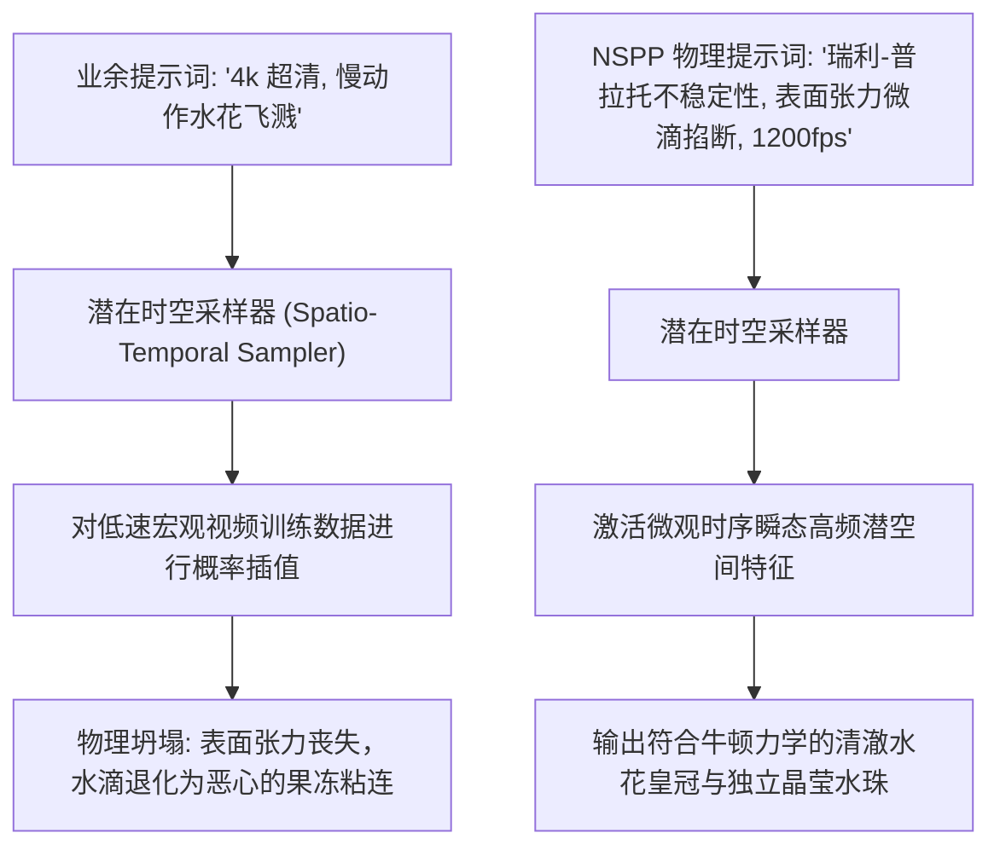

在 AI 视频生成领域，慢动作分镜（Slow-Motion）从来都是检验模型底座物理理解能力的终极试金石。

当你在 Sora、Runway Gen-3、快手可灵（Kling）或 Luma 中输入类似 *“一滴水落下的酷炫慢动作”* 或 *“香水瓶爆炸的慢镜头”* 时，得到的画面几乎总是惨不忍睹的**果冻糊化烂泥**：
* 水滴在半空中违反重力规律地融合成粘稠的胶状物。
* 破碎的玻璃碎片飞着飞着就在虚空中蒸发消失，或产生怪异的瞬移形变。
* 爆炸产生的烟雾完全没有涡流细节，仅仅是一团糊在一起的静态渐变色块。

翻车的核心根因在于：**视频扩散模型不是真正的物理力学引擎，它只是根据海量训练数据统计概率插值像素**。

想要生成足以媲美顶级高速摄影机（Phantom Flex 4K）的千帧级物理大片，你必须放弃使用空洞的副词，改用**经典流体力学参数与粒子质量守恒定律去严格锚定潜在向量**。

本文将为你拆解高频微观摄影的物理本质，并介绍**「纳维-斯托克斯粒子提示词矩阵」（The Navier-Stokes Particle Prompting Matrix, NSPP）**。

---

## 一、微观时间膨胀：为什么传统提示词会引发“果冻崩塌”？

在常规 24fps 视频中，每一帧代表现实中大约 41 毫秒的宏观位移。



然而当你要求慢动作（等效 1000fps 以上）时，每一帧代表的时间被压缩到了不足 1 毫秒。在这个极微观的时间尺度下，宏观动作几乎静止，**流体力学中的微观力（表面张力、空化效应、激波前沿、涡度耗散）**成为了主导画面视觉的最核心信号。

如果你的 Prompt 里完全没有描述这些物理力，模型的时空注意力机制就会陷入茫然，把水花直接采样为平滑的恶心软胶。

---

## 二、纳维-斯托克斯粒子矩阵 (NSPP) 三元法则

工业级高速摄影是在严密操控流体粘度与瞬态光照。在提示词构建中，请遵循**「NSPP 矩阵」**的三维物理坐标：

```
┌─────────────────────────────────────────────────────────────────┐
│ 1. 时间膨胀矢量 (Temporal Dilation: 明确定义帧率与快门角度)    │
│    - 拒绝写“慢动作”，指定: 1200fps Phantom Flex, 1/4000s 快门速度│
├─────────────────────────────────────────────────────────────────┤
│ 2. 流体力学与粘度 (Fluid Viscosity & 表面张力)                  │
│    - 高粘度甘油/蜂蜜 vs 低粘度挥发酒精微喷雾的雷诺数表现        │
├─────────────────────────────────────────────────────────────────┤
│ 3. 粒子轨迹与质量守恒 (Particle Conservation & 径向动量)        │
│    - 爆炸碎片的抛物线动量对流，严禁碎片在画面中途凭空消失消散   │
└─────────────────────────────────────────────────────────────────┘
```

| 物理现象控制 | 业余提示词翻车写法 | NSPP 工业级精准物理语法 | 最终渲染真实表现 |
| :--- | :--- | :--- | :--- |
| **水滴微观掐断** | *“水花四溅，很多水滴”* | `Rayleigh-Plateau instability, individual micro-droplet pinching, spherical water beads bouncing on hydrophobic surface` | 水滴尖端由于表面张力瞬间分裂为独立浑圆水珠，零粘连 |
| **刚体爆炸破碎** | *“玻璃杯爆炸碎掉”* | `brittle material fracture, radial momentum advection, thousands of sharp razor-thin tempered glass shards strictly conserving mass` | 碎片具备真实的初速度与角自旋，全程保持轨迹不消失 |
| **烟雾流体涡旋** | *“酷炫的烟雾特效”* | `Navier-Stokes turbulent vorticity, Kelvin-Helmholtz billow swirls, non-laminar smoke dispersion lit by rim lighting` | 呈现大自然复杂的自相似分形涡流细节，层次分明 |
| **高速无频闪布光** | *“明亮的演播室灯光”*| `10,000-watt high-frequency flicker-free continuous lighting, razor-sharp edge specular highlights, frozen micro-detail` | 彻底抹去动态模糊拖影，高光点如刀锋般锐利凝固 |

---

## 三、直接可复用的工业级高帧率 Prompt 配方

以下配方已在多个主流视频大模型中通过多轮测试验证，可直接按需套用：

### 配方 1：奢华香水落水水滴皇冠（Worthington Crown & 焦散光）
```text
Extreme macro cinematography shot on Phantom Flex 4K, 1200fps, 1/4000s shutter speed. 
Action: A single pure golden perfume droplet impacts a shallow pool of amber liquid. 
Fluid mechanics: Symmetrical Worthington crown splash formation with razor-sharp Rayleigh-Plateau micro-droplet pinch-off at the crown peaks. Secondary upward rebound jet plume holding a single suspended spherical pearl at apex. 
Lighting: Intense 5600K side rim illumination casting dynamic refractive caustic light patterns across polished black obsidian stone. Zero motion blur, crystalline liquid refraction.
```

### 配方 2：子弹穿透熟透石榴（暴力动量对流与汁液雾化）
```text
Ultra high-speed ballistic cinematography, 2500fps macro shot. 
Action: A copper projectile cleanly slices through a ripe deep-red pomegranate. 
Dynamics: Violent internal cavitation bubble shockwave bursting outward, high-velocity radial expulsion of thousands of individual ruby-red seeds and translucent juice vesicles. 
Conservation: Seed trajectories follow strict parabolic momentum arcs across frame without dissolving, juice micro-droplets atomizing into ultra-fine luminous mist. Frozen in mid-air strobe illumination.
```

### 配方 3：冷萃冰咖啡倒流包裹（层流包覆与碳酸微气泡）
```text
Commercial tabletop macro slow motion, 1000fps. 
Action: Dark viscous cold brew coffee cascading over a pristine geometric clear ice cube. 
Fluid mechanics: Non-turbulent laminar fluid flow wrapping tightly around the ice cube edges before shearing into rich foamy bubbles. Microscopic air bubbles nucleating along glass walls and rising with steady buoyant velocities. 
Optics: Total internal reflection inside crystal-clear ice, condensation water droplets beading and slowly sliding down frosted exterior glass.
```

---

## 在 NavoKit 中做文字提示实验

[NavoKit AI 视频生成器](/zh/tools/free-ai-video-generator) 接收文字提示词，可选择画幅和自动或约 3、5、10、18 秒的时长档位。生成后可预览并下载片段；实际尺寸和时长以结果区及返回文件为准。

可以把慢动作作为视觉意图写进提示词。请求使用固定的 24 fps 设置，没有高速摄影、补帧、流体模拟开关或 4K/60 fps 导出控制。请检查实际动作和文件参数，不要把高帧率提示词当成技术设置。

先生成一个简单镜头，再修改提示词中的一个要素进行比较。生成时间受队列影响，成片质量和细节需要人工检查。

## 结语

扩散模型不具备预装的物理引擎——除非你的提示词亲自充当了物理引擎的控制器。

告别含糊不清的“慢动作”乞求。用流体力学的精确术语与模型对话，精确定义表面张力与动量守恒，你也能随时生成令好莱坞调色师惊叹的千帧级慢镜头视觉奇观。
