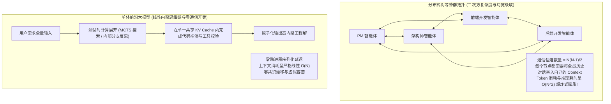
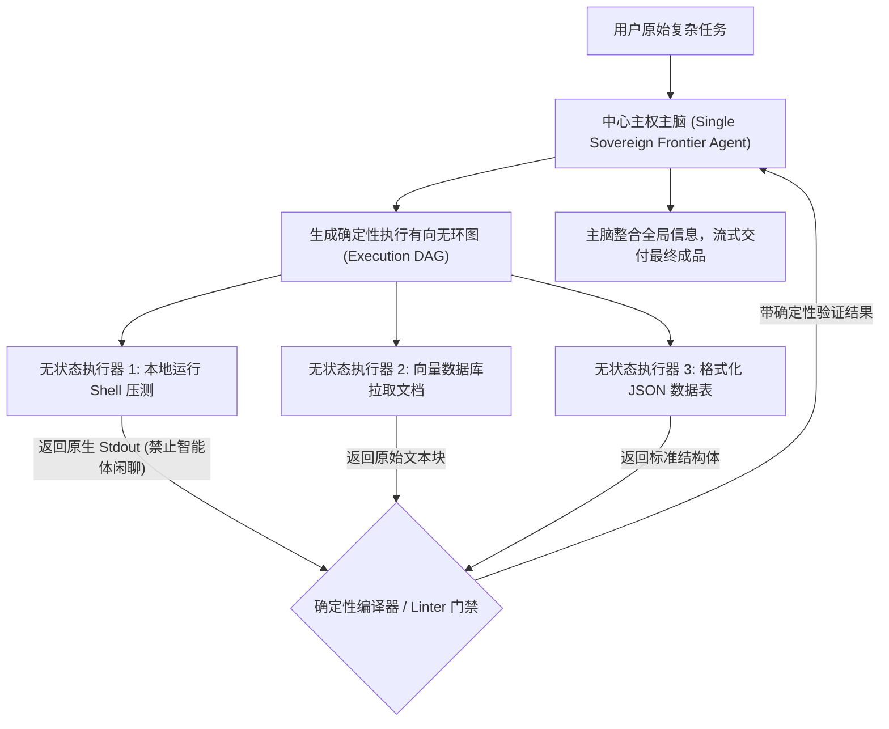

在 2024 年至 2026 年初的 AI 智能体开发狂潮中，整个行业几乎被同一种架构设计范式所席卷：**多智能体蜂群（Multi-Agent Swarms）**。

像 AutoGen、CrewAI、LangGraph 等开源编排框架的兴起，让开发者可以轻而易举地在代码中搭建起一座极其精巧的“虚拟公司组织架构”：
由一个“产品经理智能体（PM Agent）”输出需求文档，传递给“架构师智能体（Architect Agent）”拆解模块，再下发给三个并行的“程序员智能体（Coder Agents）”分别编写函数，最后由“QA 测试智能体”进行评审打分，甚至还配备了一个“Scrum 敏捷主管智能体”负责全程巡检。

在 PPT 和演示 Demo 里，这种模拟人类社会分工的机制看起来无比性感。

然而，在严肃的企业级生产工程落地中，成千上万个团队很快撞上了一堵冷酷坚硬的工程物理墙：
* 仅仅为了实现一个包含 200 行代码的简单业务接口，蜂群内的各节点相互打字客套，在没有写出一行可运行代码前就已经**烧掉了 45 万个计费 Token**。
* 智能体之间的对话死循环演变成互相谄媚（*“非常赞同你的方案！”、“你的补充太有建设性了，这是我的修订版！”、“改得太棒了，交由 QA 验收！”*）。
* 端到端复杂任务的最终交付成功率，甚至远远不及直接把全量上下文喂给一个具备超强测试时计算（Test-Time Compute）能力的单体前沿模型（Single Giant Model）。

本文将从分布式通信与数学收敛的底层机理出发，深度解构多智能体蜂群在复杂工程中的物理失效原因，并正式提出**蜂群收敛惩罚矩阵（The Swarm Convergence Penalty Matrix, 简称 SCP 矩阵）**。

---

## 1. 节点通信的物理学困局：$O(N^2)$ 消息膨胀与幻觉级联

为什么当协同智能体的数量增加时，系统的执行效率和准确率会呈现断崖式下跌？

答案隐藏在**分布式通信拓扑与上下文同步成本**之中：



### 多智能体蜂群在生产系统中的三大致命病理：

1. **消息序列化与上下文膨胀的二次方陷阱（$O(N^2)$ Communication Explosion）**  
   在一个由 $N$ 个智能体构成的对等网格拓扑中，理论通信链路数量为 $\frac{N(N-1)}{2}$。为了让每个智能体能够“理解全局上下文”，任何一个节点的发言都必须作为输入前缀重新序列化并广播追加到其余所有节点的上下文窗口中。5 个智能体讨论一个边界分支，产生的 Token 吞吐量是单个模型内部链式思考（Chain-of-Thought, CoT）的 10 倍以上。
2. **幻觉级联与错误放大效应（Hallucination Cascades）**  
   智能体本质上是概率模型。如果负责市场调研的 Agent A 产生了一个隐蔽的虚假假设（例如幻觉出一个根本不存在的外部依赖包），负责架构的 Agent B 会毫不犹豫地将该幻觉作为绝对真实前提展开后续设计，而负责编码的 Agent C 进而围绕这个不存在的库编写数百行代码。当最后的测试 Agent 报错时，系统已经沉没了巨额算力，且难以追溯溯源。
3. **共识漂移与谄媚共谋（Sycophancy & Consensus Drift）**  
   大语言模型在后训练对齐阶段普遍被强化注入了“礼貌与顺从”倾向。当缺乏编译检查器等客观环境对齐信号时，两个处于闭环反馈中的 LLM 会迅速倾向于彼此迎合赞同，达成一种“表面完全一致、底层全是漏洞”的虚假共识。

---

## 2. 蜂群收敛惩罚矩阵（The SCP Matrix）

为了量化评估一个具体的业务场景究竟适合采用分布式蜂群还是单体大模型，系统架构师可以使用**蜂群收敛惩罚指数（Swarm Convergence Penalty, SCP）**进行数学测算：

$$\text{SCP} = \frac{T_{\text{serialize}} \times (\text{Fan-Out Ratio})^2}{\text{Verifiability Score}}$$

```
┌─────────────────────────────────────────────────────────────────────────────┐
│ 蜂群收敛惩罚矩阵 (The SCP Matrix) 决策坐标系                                │
│                                                                             │
│ SCP 指数 > 8.0 ──► 系统必然崩溃区 (Immediate Collapse Zone)                 │
│                    - 强耦合的多模块代码重构                                 │
│                    - 深度推演的长篇连贯叙事与商业计划书                     │
│                    - 语义模糊的高自由度开放探索                             │
│                    ► 架构裁决: 坚决采用具备长思考能力的单体大模型 (Single)  │
│                                                                             │
│ SCP 指数 < 2.0 ──► 高效蜂群收益区 (Effective Swarm Regime)                  │
│                    - 绝对解耦的大规模并行网页抓取 (Map-Reduce)              │
│                    - 模块边界极其分明、单步带强类型检查的微服务迁移         │
│                    - 每个节点均可调用确定性编译器 / 单元测试作为物理反馈     │
│                    ► 架构裁决: 采用异步无状态专用微型智能体编排             │
└─────────────────────────────────────────────────────────────────────────────┘
```

### 决定系统是否收敛的三个核心物理参数：
* **序列化传输延迟（$T_{\text{serialize}}$）**：Agent A 完成解码吐字、将数据打成 JSON、经过消息队列派发、再由 Agent B 重新执行 Prefill 的物理壁钟耗时。
* **通信扇出比（Fan-Out Ratio）**：智能体之间内部交换的内部 Token 总量与最终向业务方交付的有效 Token 量的比值。在低效蜂群中，该比值经常高达 $60:1$。
* **客观验证性得分（Verifiability Score）**：每个节点的产出是否能被非 LLM 的物理软件（如 TypeScript 编译工具、Python 执行解释器、HTTP 状态码）以毫秒级速度判定真伪。如果必须依赖另一个 LLM 主观打分，该值趋近于 0，SCP 指数瞬间发散。

---

## 3. 架构正面决战：多智能体编排 vs 单体前沿大模型

| 核心评估指标 | 5 节点对等智能体蜂群 (CrewAI / AutoGen) | 单体具备长 CoT 的前沿大模型 (o1/o3/Claude 3.5) |
| :--- | :--- | :--- | :--- |
| **完成 500 行工程代码消耗 Token**| 350,000 – 800,000 Token (充斥大量冗余废话)| 30,000 – 70,000 Token (紧凑的高密度思考) |
| **端到端交付壁钟耗时 (Wall Clock)**| 180 秒 – 400 秒 (串行排队与网络等待) | **30 秒 – 80 秒 (连续流式吐字输出)** |
| **全局架构一致性与接口匹配度**| 极低 (各节点参数命名与数据结构经常错位) | **极高 (全局上下文处于同一个注意力空间)** |
| **异常恢复与自纠错能力** | 极度复杂 (需要跨节点的全局状态回滚) | **直接高效 (模型在自身思维链内原路回溯重试)** |
| **运维监控与基础设施复杂度** | 极高 (需要搭建消息总线、分布式调用链追踪) | **极低 (标准无状态单一 API 调用)** |
| **生产环境最佳适用场景** | 易并行的离线批处理任务 (如海量研报提取)| **深度复杂推理、系统架构设计、算法工程编写** |

---

## 4. 2026 年现代生产架构的标准答案：“轴辐式”工具执行范式

既然去中心化的对等蜂群在复杂任务中容易失控，现代企业级 AI 架构究竟应该走向何方？

业界头部团队已经普遍抛弃了“虚拟组织架构”的拟人化幻想，统一收敛至**轴辐式工具执行范式（Hierarchical Hub-and-Spoke Pattern）**：



### 轴辐式架构的三大落地铁律：
1. **执行器之间禁止横向通信（No Peer-to-Peer Chat）**  
   卫星执行器（Worker）之间绝对不允许直接发消息。它们必须被当成纯粹的、无状态的“远程工具函数（RPC Tool）”，其唯一职责是接收指令、操作物理环境并直接向中心主控节点汇报原始返回值。
2. **非 LLM 确定性防波堤（Deterministic Air-Gaps）**  
   任何工具的执行结果在喂回中心主控模型之前，必须经过确定性的代码验证门禁（如类型检查、正则校验、语法解析）。绝不用大模型去验证大模型的输出。
3. **一个大脑，千双触手（One Brain, Many Hands）**  
   把最宝贵的注意力算力和战略推理能力严格集中在一个具备庞大上下文和深度测试时计算的前沿模型上；将所有机械的、不需要发散推理的检索和测试动作降级分发给边缘工具执行器。

---

## 总结

多智能体蜂群的浪漫叙事，在现实工程的算力账单与收敛极限面前必须经历祛魅。

在软件工程、复杂数学推导与高密度决策等强耦合领域，将全量上下文完整保留在单一模型的注意力张量内，辅以测试时计算的自省回溯，在性能、稳定性与成本效益上全面碾压了松散的拟人化多 Agent 编排。

理性评估 **蜂群收敛惩罚矩阵（SCP）**，告别虚幻的组织架构模拟，用“强中心主脑 + 确定性无状态工具链”重构你的生产系统，才是 2026 年最成熟的智能体工程选择。
