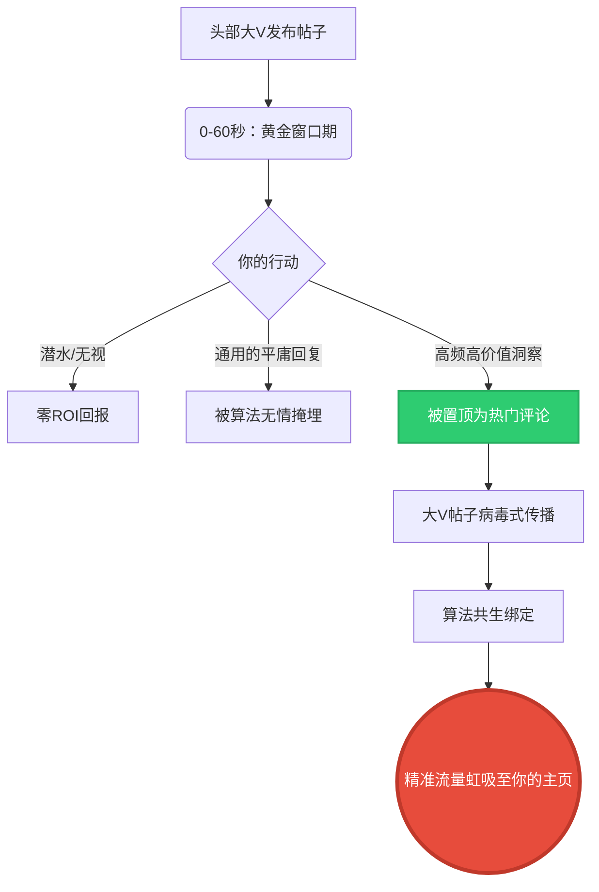

近二十年来，“1%定律”一直是社交网络的金科玉律：1%的人创造内容，9%的人参与互动，90%的人默默潜水。如果你在打造品牌，以前的任务很简单——成为那1%。耗费数小时去起草完美的推文连载、拍摄无瑕疵的视频，或者撰写终极指南。

但是，当我们一头撞进2026年的下半场时，整个流量版图发生了剧烈的震荡。潜水不再仅仅是被动；在算法层面，潜水对你的账号触达率来说就是判了死刑。更令人震惊的是，传统的内容创作正面临严重的ROI（投资回报率）危机。各大平台内容泛滥，信息流被彻底拥堵。如今真正的战场已经不再是主信息流——而是**评论区**。

欢迎来到基于评论的算法黑客时代。在这个时代，高频参与感主导了一切，而AI辅助的评论已经正式成为了全新的“内容创作”。

## 原始1%定律的崩塌

看看过去十二个月X、LinkedIn和Reddit的数据。这些平台已经明确地对他们的推荐引擎进行了重新设计，现在的算法将**对话深度**的优先级排在**广播触达率**之上。一条没有任何回复的孤立帖子，无论你有多少粉丝，都会在14分钟内死亡。但是，在一个头部大V帖子下方引发激烈辩论的评论呢？它可以吸走成千上万的个人资料点击，并持续数天为你引流。

现实情况是，创作原创内容需要庞大的时间成本，而且有机分发算法正在前所未有地挤压创作者，逼迫他们“付费买量”。然而，评论区依然是一片未被完全开垦的西部荒野——这是一个纯粹的实力场，一条见解深刻、观点逆势或者极其幽默的回复，其曝光指数完全可以超越原作者的帖子。

你不需要成为创造帖子的那1%。你需要成为劫持对话的那0.1%。

## 微互动雪球效应 (The Micro-Engagement Snowball Effect)

我们称这种新范式为**微互动雪球效应**。这个框架建立在一个残酷的数学真相之上：一篇帖子生命周期内的前60秒，决定了它90%的总触达率。如果你能在这个黄金窗口期注入一条具有高留存率的评论，算法就会将你的回复与帖子的核心流量动能绑定在一起。随着帖子的爆发，你的评论也会随之裂变。

### 该框架是如何运作的：

1. **速度拦截 (Velocity Interception)**：监控你所在领域的头部高杠杆账号。他们发帖的那一秒，倒计时开始。
2. **语境劫持 (Contextual Hijacking)**：不要留下类似“好文！”这样毫无营养的废话，而是抛出极其具体的、有增量价值的见解，或是结构化的反面论点。
3. **算法共生 (Algorithmic Symbiosis)**：平台的AI会将你的评论标记为“对话驱动源”，并将你的回复固定在顶部。
4. **流量虹吸 (Traffic Siphoning)**：10万个人阅读了这篇帖子，4万人滑动浏览了评论区，1万人看到了你被置顶的回复，1000人点击了你的个人主页。你在零广告支出的情况下，获得了极高意向的精准流量。

## 人类延迟的致命缺陷

如果“微互动雪球效应”依赖于最初的60秒，那么人类的生物学限制就是你最大的瓶颈。你不可能24小时坐在桌前疯狂刷新信息流。即使你在第15秒抓住了帖子，起草一篇高质量、非通用、结合语境的精彩回复也需要时间。当你按下“发送”键时，已经有40个人挤进了这个空间。你失去了起量的势能。

此外，如果你求助于基础的自动化脚本，平台会立刻屠宰你的账号。我们早就过了粗制滥造机器人的时代。现代的推荐引擎使用情感分析和语义映射来标记那些毫无灵魂的AI回复（比如“哇，太真实了！感谢分享！”）。如果你听起来像个机器人，你就会被影子封禁（Shadowban）。毫无商量余地。

这正是该策略从纯理论转向武器化执行的转折点。

## 用 NavoKit 起草，再人工核对

把讨论背景以及你自己的补充观点写进 [NavoKit AI 社媒文案](/zh/tools/ai-social-booster) 的输入框，也可以用文字补充受众和语气要求。工具会请求生成 X、LinkedIn、Instagram 文案及开场句，供你选择、编辑和复制。

它不会监控信息流、自动评论、持续学习你的个人语气或代你发布。

保留能核实的事实，删除未经证实的数字、个人经历和效果承诺；最后由你检查平台长度、语气与内容，再自行发布。
