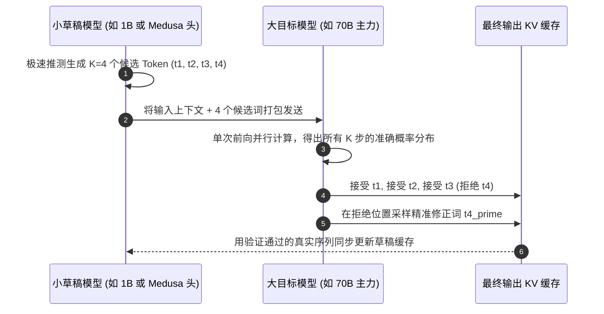

大模型推理（LLM Inference）在单批次（Single-Batch）生成时的底层瓶颈，从来都不是 GPU 的算力（FLOPS），而是 **显存带宽（HBM Bandwidth）**。

在传统的自回归（Autoregressive）解码过程中，每生成一个单一 Token，GPU 都必须把全量数百亿的模型权重参数从显存中完整读取到计算核心一次。以一个 70B 参数的 FP16 模型为例，每吐出一个字符，就需要在显存总线上狂搬约 140 GB 的数据——不论这个字符是一道复杂的逻辑推理，还是一个毫无悬念的逗号。

这种“显存带宽受限（Memory-Bound）”的物理特性，导致昂贵的 GPU 计算单元在单用户推理时的利用率经常不足 15%。

而**投机解码（Speculative Decoding）**的出现，彻底打破了这一物理枷锁：它能在**输出质量 100% 完全无损（数学等价）**的前提下，将大模型端到端推理速度提升 **2.5 倍至 3.5 倍**。

本文将从底层数学推导出发，解析投机采样的验证机制、Medusa 多头草稿架构以及生产级落地实践。

---

## 一、自回归瓶颈 vs. 投机并行验证机制

投机解码之所以能大幅提速，是因为 GPU 极其擅长“并行批量计算”，但在“串行循环读取”时极度缓慢。

```
传统自回归（被显存带宽卡死：每步都搬 140GB）：
[Token 1] ──(读取140GB)──► [Token 2] ──(读取140GB)──► [Token 3] ──(读取140GB)──► [Token 4]
总显存读取量：3 次 × 140GB = 420GB

投机解码（小模型草稿预判 + 大模型单次批量验证）：
小草稿模型 (极速): 10ms 内一口气猜出 [t1, t2, t3] 三个候选词
大目标模型 (验证): 在一次 140GB 的前向传递中，【并行验证】这 3 个词！
总显存读取量：1 次 × 140GB = 140GB（吞吐量直接翻 3 倍！）
```



---

## 二、数学证明：为什么投机解码 100% 无损？

很多人误以为投机解码类似量化剪枝，会导致智商下降。**事实上，投机解码是纯粹的无损数学采样。**

假设草稿模型给出的候选词概率分布为 $Q(x)$，大目标模型的真实概率分布为 $P(x)$：

1. **接受判定准则**：大模型以如下概率接受草稿词 $x$：
   $$\alpha = \min\left(1, \frac{P(x)}{Q(x)}\right)$$
2. **残差补偿采样**：若 $x$ 被大模型拒绝，则直接从两个分布的非负差分归一化残差中重新采样替补词：
   $$P'(x) = \max\left(0, P(x) - Q(x)\right)$$

经严格数学证明，整个联合分布在边缘化后，**最终吐出的 Token 分布与直接用 70B 大模型慢吞吞一步一步采样得到的概率分布完全严格恒等**。无论困惑度（Perplexity）还是代码准确率，没有任何一丝一毫的退化。

---

## 三、主流投机架构演进对比

| 架构类型 | 工作机制 | 显存与部署开销 | 典型提速比 ($\gamma$) |
| :--- | :--- | :--- | :--- |
| **独立小草稿模型** (如 Llama-8B 辅助 70B) | 独立运行一个小模型生成前序词 | 显存需同时容纳两个模型，有调度延迟 | $1.8\times - 2.4\times$ |
| **Medusa 多头自投机** (Self-Drafting Heads) | 在大模型最后一层外挂数个轻量 MLP 预测头 | 几乎零额外显存占用（参数增加 <3%）；无跨进程通信 | **$2.5\times - 3.2\times$** |
| **Prompt-Lookup (N-Gram 投机)** | 在已有上下文或提示词中通过纯字符串匹配预判 | 零显存开销；特别适合 JSON 结构化输出与 RAG 复述 | $1.4\times - 1.9\times$ |

---

## 四、投机接受率与业务负载的关系

投机解码的实际提速效果，取决于草稿预测的**接受率（Acceptance Rate $\alpha$）**：

```
提速倍数 (Speedup)
  ▲
4x│                                           [多分支树状投机 (Tree Attention)]
  │                                     * * * *
3x│                              * * *
  │                       * * *
2x│                * * *        [单分支顺序投机]
  │         * * *
1x│───*─*─────────────────────────────────────► 候选词接受率 (α)
    0%    20%    40%    60%    80%    100%
```

### 生产环境典型业务的接受率表现：
* **代码生成与 JSON 格式化**：接受率通常 **$\alpha > 85\%$**。因为语法关键字（`import`, `function`, `{ "status":`）高度确定，大模型几乎百分之百全盘接受，提速最夸张（可达 3.2 倍以上）。
* **开放式小说创作**：高温采样下多样性高，接受率通常在 55%～65%，提速约 1.8 倍。

---

## 五、前沿优化：树状注意力机制 (Tree Attention)

在最新一代的推理引擎（vLLM、SGLang、TensorRT-LLM）中，投机解码普遍结合了**树状分支投机（Tree Attention）**：

草稿端不再只预测单一的一串词 $[t_1 \rightarrow t_2 \rightarrow t_3]$，而是同时生成一个候选排列树：

```
                  ┌──► t2_a ──► t3_a
          ┌──► t1_a
          │       └──► t2_b ──► t3_b
起点 ─────┤
          │       ┌──► t2_c
          └──► t1_b
                  └──► t2_d
```

大模型通过一次带掩码的 Tree Attention 并行计算，哪怕其中一条支路猜错，另一条支路往往能命中，使得单步前进 3~5 个 Token 的概率大幅提升至 85% 以上。

---

## 结语

在全行业算力紧张、显存带宽依然是物理死穴的当下，**投机解码是企业降低推理延迟、提升 GPU 吞吐量最划算的一项技术改造**。

无需重训大模型，无需忍受低精度量化带来的智商损伤，借助投机解码与树状验证，即可在生产环境中直接收割 3 倍的速度红利。
