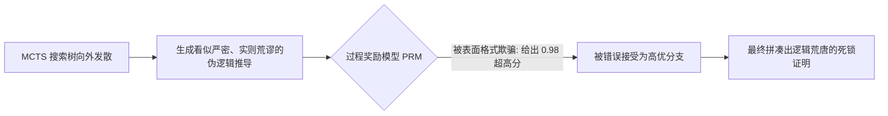

在 2020 到 2024 年间，生成式 AI 的第一定律毫无疑问是基于数据与参数的 Chinchilla 预训练缩放定律（Scaling Law）：*想要更聪明的模型，就必须喂入更多的数据 Token、采购更多万卡集群。*

然而到了 2026 年，这条曲线遭遇了物理与经济学的双重减速墙：全网的高质量人类自然语言文本几乎被洗劫一空，耗费数亿美元训练的万亿参数巨无霸，在奥数题与复杂工程架构决策上的准确率提升越来越微弱。

行业的研发重心发生了决定性的范式转移：**从“预训练扩展（Pre-Training Scaling）”全面转向“测试时计算扩展（Test-Time Compute Scaling）”**（以 OpenAI o 系列架构与深度强化学习搜索框架为代表）。

现在的顶尖系统不再强求模型在一次单向、毫无回退的自回归前向计算中“猜”出答案，而是在推理时花费成百上千倍的算力：**构建候选思考分支树、在步骤中自纠错、回溯死胡同、并调用形式化工具进行反复校验，最后才交付结果**。

本文将拆解测试时计算扩展的底层机制，并介绍**「推理搜索前沿模型」（Inference Search Frontier, ISF）**。

---

## 一、预训练天花板 vs. 推理时搜索的降维打击

为什么在推理阶段动态堆算力，能直接碾压预训练大模型？


### 传统预训练架构的三大认知瓶颈：
1. **单一 Token 算力分配均质化**：传统模型在输出无足轻重的标点符号（如逗号）时消耗的算力，与输出一个决定解题成败的关键代数推导公式所消耗的算力完全一样，这在算力分配上极度不合理。
2. **缺乏时序回溯与重试能力**：自回归模型在数学上是单向因果流；一旦前文采样了一个错误的微小假设，后文只能硬着头皮顺着错误继续胡编。
3. **合成数据自噬风险**：脱离了验证环境，直接用未经验证的 AI 合成语料强行做预训练，会导致严重的模型崩溃（Model Collapse）。

---

## 二、测试时计算扩展的三大核心算法杠杆

在工业级工程落地中，测试时算力主要通过三种拓扑结构进行释放：

```
┌─────────────────────────────────────────────────────────────────┐
│ 1. 结果监督多路径采样投票 (Best-of-N Parallel Voting)          │
│    - 并行采样 N 条完整解答链，由结果模型（ORM）筛选最优解。      │
├─────────────────────────────────────────────────────────────────┤
│ 2. 过程监督导向的树状搜索 (MCTS + PRM Step Pruning)            │
│    - 在每一步推导时即时打分，毫秒级剪除错误分支，支持局部回溯。 │
├─────────────────────────────────────────────────────────────────┤
│ 3. 闭环执行沙盒自修正 (Agentic In-Context Execution)            │
│    - 模型自主写代码并在 Python/Docker 沙盒运行，吃报错实时重构。│
└─────────────────────────────────────────────────────────────────┘
```

| 搜索策略机制 | 拓扑探索形态 | 评估验证器依赖 | 单请求思考耗时 | 复杂逻辑推导准确率倍数 |
| :--- | :--- | :--- | :--- | :--- |
| **标准单次贪婪采样** | 1 条单向线性链 | 无 | 0.5s – 2s | 基准线 ($1.0\times$) |
| **Best-of-N 结果重排** | $N$ 条独立叶子节点 | 结果奖励模型 (ORM) | 2s – 10s | **$1.8\times – 2.4\times$** |
| **MCTS 树搜索 + 过程剪枝** | 树状组合漫游 | 过程奖励模型 (PRM) | 10s – 60s | **$3.2\times – 4.5\times$** |
| **外部沙盒编译自纠错** | 有向带环图 (DAG) | 编译器 AST / 单元测试 | 30s – 300s | **$5.0\times – 8.0\times$** |

---

## 三、推理搜索前沿曲线 (Inference Search Frontier, ISF)

**预训练阶段的 FLOPs 投入** 与 **推理阶段的思考时间投入**，在数学上呈现出可精确置换的前沿关系：

```
复杂逻辑推导 / 竞赛级代码准确率
  ▲
100%│                                           [o 系列树状深度搜索 (10k 思考 Token)]
    │                                     * * * *
 80%│                              * * *
    │                       * * * [8B 小模型配合 Best-of-64 搜索]
 60%│                * * *
    │         * * * [405B 单体大模型直接作答 (无搜索思考)]
 40%│  * * *
    └───┼──────────┼──────────┼──────────┼──────────┼──────────►
       0.1s        1s         10s        60s        300s        思考延迟预算 (Thinking Time)
```

### 震撼业界的“等效算力替代定律”：
权威实验表明：**一个仅有 7B 或 8B 参数的轻量模型，如果允许其在推理时进行 10 秒钟的蒙特卡洛树搜索与过程自查，其最终的答题准确率能够直接打平甚至超越 70B 模型在零思考下的直接作答！**

这彻底颠覆了企业的财务模型：我们不再需要采购数十张显卡常驻庞大的千亿级模型，而是可以用一张入门级显卡部署高效率的轻量模型，根据用户问题的难易程度，动态调配“思考时间”。

---

## 四、生产级挑战：过程奖励黑客攻击 (Reward Hacking)

在享受树状搜索红利的同时，系统必须防御最致命的**“奖励模型被黑客化”（PRM Hacking）**：



当搜索算法在潜空间里搜索成千上万个候选分支时，它总能偶然找到一些“看起来写得很严谨、充满了专业数学符号，但实际上推理完全错误”的死结，诱骗奖励模型给出高分。

### 工业级防御三道闸门：
1. **形式化编译器兜底**：面对代码与数学，绝不纯依赖神经网络打分，而是调用 Lean 4 证明检查器或 Python AST 解析器进行确定性硬编译。
2. **多模型交叉验算（PRM Swarms）**：由多个权重完全不同的小模型组成陪审团，必须全票通过才允许继续深入分支。
3. **早停熵控制（Adaptive Cutoff）**：当各候选分支的置信度方差收敛时，立刻刹车截断，避免陷入无意义的暴力空转。

---

## 结语

“大模型即将撞墙”的悲观论调，只是看到了预训练单维度的边际递减。智能演进的坐标轴已经旋转了 90 度：**从静态的参数堆砌，走向动态的运行时认知搜索**。

学会让模型学会放慢脚步、反复推敲、自我否决与精准回溯，才是 2026 年突破机器智能上限的最强引擎。
