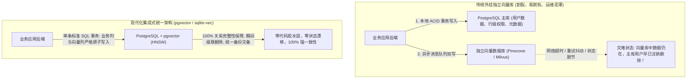

在 2023 年大模型爆火的初期，风险投资机构向一众“独立向量数据库”（Standalone Vector DB，如 Pinecone、Weaviate、Milvus、Qdrant）狂掷了数亿美元。当时的故事极具诱惑力：*向量嵌入是全新的数据范式！传统关系型数据库根本无法承受高维 HNSW 索引的实时写入与召回！*

然而到了 2026 年，分布式软件工程的铁律再次应验：

**“向量”不是一种独立的数据库，它只是一种普通的索引数据类型（Data Type）。**

正如当年的 JSON、地理空间坐标（GIS）和全文检索一样，高维向量检索已经被历经数十年风雨的基础关系型数据库彻底吸收同化——最具代表性的就是 **PostgreSQL（通过 `pgvector` 扩展与 HNSW 索引）** 以及 **轻量级嵌入式 SQLite（通过 `sqlite-vec` 插件）**。

在生产环境中强行外挂一个独立的向量数据库，给研发团队带来了难以承受的运维灾难：**“双数据库状态同步梦魇”（The Two-Database Sync Nightmare）**。

本文将深入拆解独立向量引擎被通用数据库“降维吞噬”的必然逻辑，并介绍**「集成向量局部性定理」（Integrated Vector Locality Theorem）**。

---

## 一、双数据库架构的分布式同步灾难

当你把业务主数据放在 PostgreSQL，却把向量 Embedding 孤立在第三方的向量数据库时，你的系统不得不退化为分布式跨库双写架构，且缺乏分布式事务保证。



### 独立向量库在工业界引发的 4 大死穴：
1. **双写竞态条件（Dual-Write Race Conditions）**：当用户在主库中注销账号或删除敏感合同，如果同步到向量库的异步 Webhook 遭遇网络重试失败，已删除的数据依然会从向量库被检索出来，直接引发灾难性的合规与隐私泄露事故。
2. **元数据过滤性能反噬**：在真实企业业务中，没有人脱离业务上下文去盲目做相似度计算。你的查询一定是：*“查找租户为 A、组织架构为 B、创建时间在过去 30 天且用户拥有只读权限的向量”*。独立向量库在面对复杂的元数据过滤时无法进行高效 JOIN，只能逼着开发者在向量库里冗余备份巨量的非结构化元数据。
3. **备份灾备（PITR）完全割裂**：当数据库遭遇故障需要时间点恢复（PITR）时，你根本不可能将两个完全不同引擎、不同存储底层的数据库回滚到微秒级一致的时间截面。
4. **额外的网络往返延迟**：在应用、主库与云端第三方向量服务之间反复穿梭，平白无故增加了 30ms~80ms 的 P99 跨网络延迟。

---

## 二、pgvector 的 HNSW 性能平替奇迹

过去批评 `pgvector` 的主要论据只有一条：*“Postgres 算向量太慢，抗不住百万级高频并发。”*

但随着 **pgvector 0.7+ 版本的成熟、并行 HNSW 索引构建以及向量量化技术** 的落地，这一性能鸿沟已经被彻底抹平：

```
P99 查询延迟 (在 100 万 1536 维向量高频召回基准下)
  ▲
60ms│ [早期的 pgvector IVFFlat (2023 年已淘汰)]
    │          ▲
40ms│          │      [独立云端向量 SaaS (Pinecone / Milvus)]
    │          │                 * * * * *
20ms│          │           * * *
    │          └────► * * * [现代 pgvector 0.7+ HNSW 索引 (2026)]
 0ms└───┼──────────┼──────────┼──────────┼──────────► 单节点并发 QPS
       100        500        1,000      2,500
```

| 评估维度指标 | 独立第三方向量云 SaaS | PostgreSQL + pgvector | 嵌入式 sqlite-vec |
| :--- | :--- | :--- | :--- |
| **可承载数据规模** | 500 万 – 5,000 万 | **单节点轻松承载 2,000 万** | **单库承载 50 万 (内存极限)** |
| **权限与元数据过滤** | 粗暴的 JSON 过滤，无法 JOIN | **原生 SQL JOIN、外键级联、行级安全策略** | 标准本地 SQLite 语法 |
| **事务一致性保障** | 纯最终一致性（有延迟） | **全量 ACID 严格可串行化** | 进程级原生 ACID 事务 |
| **每月额外基建成本** | \$800 – \$3,500 / 月 | **\$0 (直接复用现有主库)** | **\$0 (轻量运行在二进制内部)** |

---

## 三、边缘与端侧的终极轻量解：sqlite-vec

如果说在后端企业级集群中 `pgvector` 已经成为绝对霸主，那么在桌面端应用、IDE 插件与智能手机边缘计算中，**`sqlite-vec` 则完成了对向量引擎的全面重塑**：

```
┌─────────────────────────────────────────────────────────────┐
│ 你的本地客户端进程 (Node.js / Python / Rust / Tauri / Electron)│
│ ┌─────────────────────────────────────────────────────────┐ │
│ │ 进程内原生内存: SQLite 引擎                            │ │
│ │ ┌───────────────────┐     ┌───────────────────────────┐ │ │
│ │ │ 传统业务数据行    │ <-> │ sqlite-vec 扩展高维向量表 │ │ │
│ │ └───────────────────┘     └───────────────────────────┘ │ │
│ └─────────────────────────────────────────────────────────┘ │
└──────────────────────────────┬──────────────────────────────┘
                               │ 零拷贝内存 SIMD 指令集点积运算 (AVX-512 / ARM NEON)
                               ▼
               [实现 < 1.5ms 极速本地毫秒级向量召回]
```

### 为什么开发者正在疯狂拥抱 `sqlite-vec`：
* **零网络延迟**：向量计算完全在客户端进程内存里完成，调用 CPU 的 SIMD 指令集，单次点积耗时仅需 **0.8 毫秒**。
* **零维护开销**：不需要账号、没有 API 密钥、没有高昂的 SaaS 账单。整个数据库就是一个干净的 `.db` 文件，随时随地随包分发。
* **为桌面端 Agent 而生**：本地知识库笔记、IDE 代码自动补全插件以及车载端侧 Agent，都可以依托一个单文件 SQLite 实现千万次流畅的本地 RAG 检索。

---

## 四、独立向量数据库真的彻底没用了吗？

独立向量引擎（如 Milvus、Vespa）还有生存空间吗？

有，但它已经被极度压缩到了**“十亿级超大规模搜索（0.1% 的顶级互联网玩家）”**的极端场景：

1. **数十亿规模的多模态推荐系统**：像 Spotify、Pinterest、小红书那样需要对数亿张图片和音频特征向量进行跨 GPU 集群的高并发分布式聚类分片。
2. **极端高频重排（QPS > 50,000）**：秒级并发检索量超过数万次，常规单机 PostgreSQL 连接池确实会成为瓶颈。

但对于全行业 99.9% 的企业产品——业务向量总数在 1,000 万以内的真实项目，**PostgreSQL + pgvector 在架构优雅度、开发维护效率和综合成本上均形成了不可动摇的压倒性优势**。

---

## 结语

技术发展的规律始终是：单功能的玩具项目会被成熟的基础设施彻底吞噬。

别再为你本就脆弱的系统堆砌昂贵而割裂的独立向量数据库。让向量回归到关系型数据库中，享受坚固的 ACID 事务与无缝的 SQL 联查，把省下来的精力投入到真正能拉动增长的核心业务逻辑中去。
