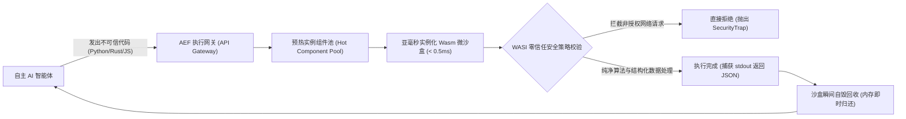

当自主 AI 智能体（Autonomous AI Agents）开始自主编写并执行代码——无论是生成一段 Python 脚本查询复杂数据、在财务分析器中运行动态蒙特卡洛模拟，还是在本地环境执行 Shell 脚本工具时，每一个工程架构师都会面临最根本的安全与性能拷问：

**我们究竟应该在何处物理隔离并安全地运行这些由大模型动态生成的不可信代码（Untrusted Code）？**

在早期智能体系统的原型阶段，工程团队习惯性地直接搬出标准 Docker 容器方案。

然而进入 2026 年，随着千万级企业级智能体集群全天候并发运转，现实的生产环境迅速给依赖 Linux 容器架构的团队泼了冷水：
* **冷启动延迟灾难**：启动一个全新的 Docker 容器哪怕优化到极致也需要 500ms 到 2.5 秒，彻底击碎了智能体即时思维链（CoT）的实时交互体验。
* **物理内存开销爆炸**：每个容器 baseline 开销高达 50MB–200MB，数百个并发工具调用足以将宿主机内存彻底榨干。
* **Linux 内核共享风险**：容器与宿主机共享操作系统内核，一旦智能体被恶意 Prompt 注入诱导利用未修补的内核漏洞（如 Dirty COW 或 eBPF 提权漏洞），攻击者即可轻易实现容器逃逸（Container Escape），接管宿主机 Root 权限。

业界的技术路线已发生根本性转移：**基于 WebAssembly (Wasm) 与 WASI（WebAssembly System Interface）的亚毫秒微隔离沙盒（Micro-Isolation Sandbox）**，正在成为现代 AI 智能体工具执行的绝对统治级基石。

本文将拆解 WebAssembly 微隔离的核心底层机理，并详细介绍我们在生产环境中沉淀出的**零信任智能体执行网格（The Zero-Trust Agent Execution Fabric, 简称 AEF）**。

---

## 1. 传统容器架构瓶颈 vs WebAssembly 沙盒范式转移

为什么当高频、瞬时的智能体工具调用激增时，传统 Docker 架构会不可逆地走向崩溃？

```mermaid
graph TD
    subgraph DockerIsolation ["传统 Docker / Linux 容器方案 (臃肿、高延迟、高隐患)"]
        A1["智能体生成 4 行 Python 数据处理代码"] --> B1["拉起全新 Docker 隔离容器"]
        B1 --> C1["Fork Linux 命名空间、Cgroups、挂载 Rootfs (耗时 800ms)"]
        C1 --> D1["每个实例占用 150MB 物理内存"]
        D1 --> E1["1,000 并发智能体 = 白白浪费 150GB 内存仅用于装载重复的 OS 环境!"]
    end

    subgraph WasmIsolation ["Wasm 微隔离沙盒 (亚毫秒冷启动、零冗余、数学级安全)"]
        A2["智能体生成 4 行 Python 数据处理代码"] --> B2["实例化预编译 Wasm 组件 (WASI)"]
        B2 --> C2["线性内存隔离沙盒初始化 (启动耗时仅 0.3ms)"]
        C2 --> D2["每个实例内存增量仅 30KB"]
        D2 --> E2["单台普通云服务器即可轻松承载 10,000+ 智能体无缝并发运行!"]
    end
```



### 传统容器对于 AI 智能体工作负载的致命缺陷

1. **冷启动延迟不可接受（Cold-Start Latency Penalty）**  
   智能体在思考循环中调用工具是一个闭环同步过程。LLM 生成代码片段，期待在数毫秒内获得运行结果并继续推理下一步行动。如果在中间插入 1.5 秒的 Linux 容器编排等待，用户体验将从“即时对话”骤降为“死机卡顿”。
2. **内存冗余导致的密度瓶颈（Memory Bloat & Low Density）**  
   在一台 16GB 内存的标准宿主机上，如果每个隔离环境都需要完整的 Linux 文件系统（Alpine 或 Debian 精简版），最多只能容纳数十个到上百个并发实例。绝大部分内存消耗在冗余的系统库和用户空间初始化上，算力浪费率超过 95%。
3. **内核共享与多租户逃逸隐患（Shared Kernel Attack Surface）**  
   Docker 并非真正的物理硬件虚拟化。AI 智能体生成的代码是高度不确定的黑盒，恶意行为者可以通过“间接提示注入”（Indirect Prompt Injection）在网页中植入恶意 Payload，欺骗智能体去扫描宿主机内核的 `/proc` 与 `/sys` 节点，甚至触发特权提权漏洞。

---

## 2. WebAssembly 隔离内核机理：基于线性内存的数学安全界限

WebAssembly 从根本上重构了执行沙盒的安全模型，其核心基石是**基于软件故障隔离（Software-Fault Isolation, SFI）与线性内存安全机制（Linear Memory Bounds）**：

```
┌─────────────────────────────────────────────────────────────┐
│ WebAssembly 运行时引擎 (Wasmtime / WasmEdge)                │
│ ┌─────────────────────────────────────────────────────────┐ │
│ │ 严格隔离的 Wasm 模块线性内存空间 (如上限 64MB)          │ │
│ │ - 所有指针地址均强制解释为相对于基址 0x0 的偏移量       │ │
│ │ - 硬件级 MMU 边界保护，彻底杜绝越界内存寻址与缓冲区溢出 │ │
│ ├─────────────────────────────────────────────────────────┤ │
│ │ 基于能力的显式权限系统 (Capability-Based WASI)           │ │
│ │ - 零环境特权 (Zero Ambient Authority)                    │ │
│ │ - 未显式挂载前，绝对无法访问任何宿主文件系统目录         │ │
│ │ - 未预先授权前，彻底禁止创建任何出站网络套接字 (Socket)  │ │
│ │ - 硬件级确定性指令计数器 (Gas Metering)，微秒级掐断死循环│ │
│ └─────────────────────────────────────────────────────────┘ │
└──────────────────────────────┬──────────────────────────────┘
                               │ 保证与底层操作系统内核 100% 物理级解耦
                               ▼
               [宿主机 Linux/Darwin 操作系统内核受到绝对保护]
```

### Wasm 微隔离的三大核心安全支柱

#### 1. 独立连续的线性内存空间（Isolated Linear Memory）
在 Wasm 虚拟机内部，被编译执行的代码只能读写一块由宿主严格分配的、连续的一维字节数组（Linear Memory）。所有的指针解引用均被自动注入边界检查，任何超出边界的偏移量寻址都会立即触发内存陷阱（Trap）并终止执行。被沙盒化的智能体代码在物理逻辑上根本“看不见”宿主机的物理指针、内存堆栈或邻居实例的数据。

#### 2. 基于能力（Capability-Based）的 WASI 权限模型
传统程序在启动时具有隐式环境特权（Ambient Authority）：只要当前运行用户有权访问 `/etc`，任何 Python 脚本都可以 `open('/etc/passwd')`。  
而在 WASI（WebAssembly System Interface）体系中，**默认特权为严格的零**。模块无法直接调用操作系统系统调用（syscall）。如果需要读写某个目录，必须由宿主在实例化阶段显式向其传递该特定目录的“文件描述符能力句柄”；如果不传递，整个沙盒内连文件系统的概念都不复存在。同理，网络通信、系统时钟等全部按需显式注入。

#### 3. 确定性算力计费与指令截断（Deterministic Instruction Metering / Gas）
当智能体生成包含死循环（如 `while True: pass`）或者极其耗费 CPU 的暴力算法时，传统操作系统只能依赖外部监控定时器去 `kill -9`，这存在显著的延迟与状态清理污染。  
Wasm 引擎允许在编译字节码时向每条基本块指令自动注入计费计数器（Gas Counter）。宿主可以指定当前代码执行配额为 $5 \times 10^7$ 个 CPU 指令周期。一旦配额耗尽，虚拟机在下一微秒无条件挂起并安全抛出异常，彻底杜绝 CPU 饥饿攻击。

---

## 3. 沙盒技术全景对比矩阵

| 架构评估维度 | 传统 Docker 容器 | 轻量级 MicroVM (Firecracker) | WebAssembly (Wasm/WASI) |
| :--- | :--- | :--- | :--- |
| **冷启动初始化延迟** | 500ms – 2,500ms (极慢) | 100ms – 250ms (中等) | **< 1ms (实测 0.2ms – 0.8ms)** |
| **单实例内存基础开销** | 50MB – 200MB (沉重) | 15MB – 30MB (可接受) | **30KB – 2MB (可忽略不计)** |
| **单台 16GB 宿主机并发密度** | 80 – 200 个并发实例 | 500 – 1,000 个并发实例 | **10,000 – 50,000 个瞬时实例** |
| **底层安全隔离级别** | 共享内核命名空间 (存在逃逸风险) | KVM 硬件虚拟化 (极高) | **软件故障隔离 SFI (数学级绝对确定性)** |
| **CPU 资源精确截断机制** | Cgroups OS 级粗粒度节流 | 虚拟时钟与 vCPU 限制 | **指令级精确计数 (Gas Metering)** |
| **跨架构与跨平台分发** | 强绑定底层 CPU 架构与内核 | 强绑定 x86_64 / ARM64 | **一次编译，跨系统跨架构无差异运行** |

从上表清晰可见，在处理“高并发、超短生命周期、不可信代码片段”这一典型智能体工作负载时，WebAssembly 在吞吐量与启动时延维度具有 2 到 3 个数量级的降维打击优势。

---

## 4. 零信任智能体执行网格（AEF）生产落地架构

在万级 QPS 的企业级 AI 智能体生产网关中，单靠单纯的 Wasm 运行时是不够的，还需要配套的生命周期调度治理机制。我们总结并落地了**零信任智能体执行网格（Agent Execution Fabric, AEF）**：



### AEF 网格的四大工程落地铁律

1. **组件模型与预热执行池（Pre-Initialized Hot Component Pools）**  
   对于 Python 这类动态语言，将微型解释器（如 Pyodide 或 WebAssembly 编译版 QuickJS / MicroPython）作为预编译不可变镜像加载进内存池。当智能体生成代码时，无需重新解析加载解释器，仅需通过 Wasm Component Model 将 AST 注入已处于待命状态的干净沙盒实例，耗时仅需 **0.1ms**。
2. **零出站环境网络（Zero Ambient Outbound Network）**  
   彻底切断沙盒对底层网卡的直连能力。如果智能体的 Python 脚本需要调用外部天气 API 或第三方 SaaS 服务，绝对不允许直接通过 `requests.get()` 发起裸 HTTP 请求，而必须通过宿主注入的受控 Host Function。宿主网关对请求的 URL、请求头和目标 IP 进行安全白名单阻断和敏感数据脱敏，从源头消灭 SSRF（服务端请求伪造）攻击。
3. **防抖动严格指令预算（Strict Instruction Budgets）**  
   每个工具调用实例根据业务场景赋予差异化的 Gas 预算。针对简单 JSON 解析与格式化脚本，限制在 $10^7$ 条指令以内；针对复杂数据分析脚本，限制在 $10^8$ 条指令并配合 2 秒硬超时。一旦超标立即触发熔断，避免智能体因 Prompt 逻辑混乱陷入死循环卡死系统。
4. **无残留瞬时销毁（Zero-State Instant Tear-Down）**  
   每个微沙盒严格保证“一用一弃”。执行完毕并抽取返回值后，该线性内存块立即在内存管理器中置为可用，绝不在沙盒内保留任何持久化状态，杜绝不同用户会话或不同智能体任务之间的隐式数据污染。

---

## 总结

如果说大语言模型（LLM）赋予了 AI 智能体人类级的推理大脑，那么代码执行能力就是智能体真正改造物理数字世界的双手。

然而，我们绝不能以牺牲企业生产系统的网络边界安全与算力预算为代价来换取这种灵活性。将整个 Linux 操作系统塞给每一个简单的智能体计算步骤，是对现代云原生基础设施的严重误用。

WebAssembly 凭借其极其轻量的线性内存隔离、亚毫秒级瞬时冷启动以及严格的能力权限模型，为智能体工程界提供了当前技术物理极限下最优雅的解决方案。拥抱 Wasm 微沙盒架构，是每一个构建下一代可靠智能体系统的工程团队不可逾越的核心底座。
